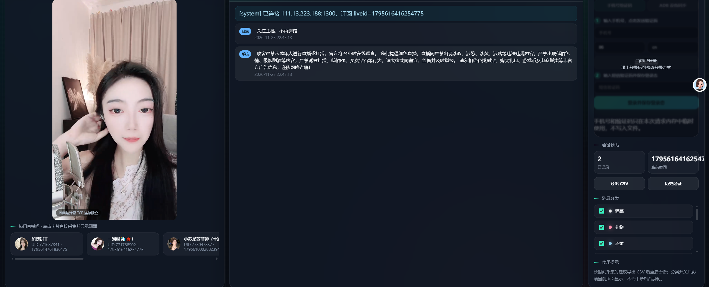

# 映客弹幕实时控制台（还在测试中）

> **项目状态：还在测试中，接口和采集行为可能随时调整。**



这是一个基于 FastAPI + Server-Sent Events 的映客弹幕实时采集与查看工程。  
它尝试从映客的私有 TCP 链路中还原弹幕数据，并提供一个适合本地调试的 Web 控制台。

---

## 项目简介

项目主要解决三件事：

1. **实时采集**：连接映客直播间，解析私有 TCP 流量。
2. **分类整理**：将弹幕、礼物、点赞、进场、关注/分享、排行等消息分类。
3. **可视化**：在 Web 控制台里查看实时消息，并支持导出 CSV。

当前 Web 端已经是深色控制台风格，包含：

- 顶部连接控制区
- 左侧直播画面与热门直播间卡片
- 中间实时弹幕流面板
- 右侧会话状态与分类过滤栏
- 消息 DOM 上限，避免长时间采集后页面越来越重

本版新增：

```text
1. 直播画面预览：HTTP-FLV 同源代理 + 本地 mpegts.js，不保存视频文件
2. 手机号验证码登录：uid/session 由 HTTP 登录获取，gid 首次 TCP 认证自动分配
3. ADB/root 登录态同步：保留原有设备读取登录态流程
4. 登录状态管理：未登录弹窗、右上角用户信息、退出登录
5. PC 左右布局：左侧画面/房间，中间弹幕，右侧控制区
6. 登录区锁定：已登录时锁定右侧登录方式，退出后自动解锁
```

---

## 快速开始

### 1. 安装依赖

```powershell
python -m pip install -r requirements.txt
```

### 2. 启动服务

可以直接双击：

```text
启动弹幕GUI.bat
```

或者手动执行：

```powershell
python -m uvicorn app:app --host 127.0.0.1 --port 8801
```

### 3. 打开页面

浏览器访问：

```text
http://127.0.0.1:8801
```

然后在页面里选择热门直播间，或输入主播 UID / 直播间链接 / liveid 后连接。

### 4. 首次登录向导

首次使用需要有效登录态。右侧“首次使用：登录向导”提供两种方式：

#### 方式一：手机号验证码登录

```text
1. 输入手机号
2. 点击“发送验证码”
3. 输入短信验证码
4. 点击“登录并保存登录态”
```

手机号和验证码只在本次请求内存中临时使用，不写入文件、不写入日志、不随仓库提交。

登录成功后会得到：

```text
uid
session
secret
```

`session` 会写入本地配置的 `sid` 字段，`gid` 会留空；首次连接 TCP 1300 时，服务端会在 `0x4004` 认证响应中分配 `gid`，采集器会自动写入本地配置。

#### 方式二：ADB/root 设备同步

```text
1. 检查环境：ADB、设备在线、root、映客是否安装
2. 打开映客登录：请在手机/模拟器上自行登录
3. 读取并保存登录态：写入本地忽略文件
```

要求：

```text
Android 设备或模拟器需要 root
需要开启 USB 调试
```

登录态保存到：

```text
reverse/references/inke_runtime_config.local.json
```

该文件已在 `.gitignore` 中忽略，不会随仓库提交。采集器启动时会优先使用它。

### 5. 登录状态

页面打开时会先检查当前是否有可用登录凭证：

```text
GET /api/session/current
```

- 没有凭证：弹出登录框，要求先登录。
- 有凭证：右上角显示当前 UID、登录方式和 `gid` 状态。
- 退出登录：删除本地凭证，并阻止继续采集。

可用凭证的判定：

```text
inke_runtime_config.local.json 存在
uid > 0
sid 非空
```

`gid` 为空不算未登录；首次 TCP 认证时服务端会分配并写回。

`inke_runtime_config.json` 现在只是协议模板，不再作为登录凭证。仓库中不会提交真实 `uid/sid/gid`。

如果没有 root 设备，可以使用“手机号验证码登录”；HTTP 登录不依赖 root 设备，缺少的 `gid` 会在首次 TCP 认证时由服务端分配。

---

### 6. 直播间画面预览

页面上方提供直播间画面区域。点击热门直播间卡片后：

```text
弹幕：TCP 1300
画面：HTTP-FLV
```

画面链路：

```text
Live_top_pc -> stream_addr
-> /api/video/stream?liveid=...
-> 后端同源流式代理
-> 浏览器 mpegts.js 播放
```

说明：

```text
视频不保存到硬盘
stream_addr / wsSecret 不暴露给浏览器
播放器 JS 已放在 static/vendor/mpegts.min.js
不接受任意视频 URL，只允许映客官方拉流域名
```

如果某个房间不在热门列表中，或没有返回 `stream_addr`，页面会提示“暂无可播放画面”，但弹幕采集不受影响。

## 主要能力

- 实时弹幕采集
- 直播间画面预览（HTTP-FLV，不保存视频）
- 分类过滤
- 会话状态展示
- CSV 导出
- 历史文件查看
- 浏览器 UI 冒烟测试
- 私有 TCP 协议探索

---

## 项目结构

```text
.
├── app.py                        # FastAPI 服务与 SSE 接口
├── inke_tcp_collector.py         # TCP 采集器与热门房间接口
├── danmu_client.py               # 弹幕客户端骨架
├── decoder.py                    # 协议解码
├── category.py                   # 消息分类
├── recorder.py                   # CSV 会话录制
├── static/
│   └── index.html                # Web 控制台
├── tests/
│   ├── selftest.py               # 基础自检
│   └── ui_smoke.spec.js          # 浏览器 UI 回归测试
├── docs/
│   ├── architecture/             # 架构文档
│   └── superpowers/              # 设计与实施记录
├── reverse/                      # 逆向研究资料与辅助脚本
└── requirements.txt
```

---

## 本地测试

基础自检：

```powershell
python tests/selftest.py
```

UI 冒烟测试需要本地服务运行在 `http://127.0.0.1:8801`：

```powershell
npx --yes --package @playwright/test playwright test tests/ui_smoke.spec.js --reporter=line
```

---

## 逆向研究说明

项目目录中保留了部分逆向研究文档和辅助脚本，主要用于理解：

- 弹幕链路
- TCP 协议候选
- 鉴权与签名流程
- 消息分类结构

仓库不会提交：

- APK 原始样本
- 反编译输出
- 抓包日志
- 导出数据
- 临时浏览器截图和测试产物

---

## 免责声明

本项目仅供学习与研究使用。  
请遵守目标应用的服务条款，控制访问频率，不要用于骚扰、爬取隐私数据或其他违规用途。

---

## 路线图

- [ ] 继续验证 TCP 长连接与订阅协议
- [ ] 提升消息分类准确率
- [ ] 优化断线重连与会话恢复
- [ ] 增加更完整的自动化测试
- [ ] 支持多房间并行采集

