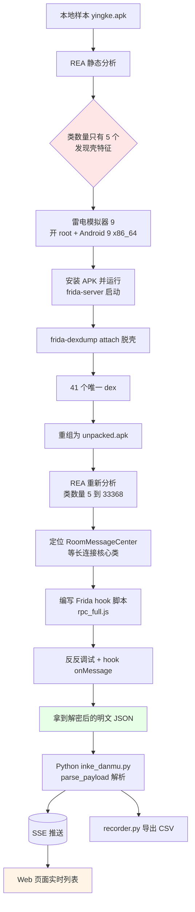
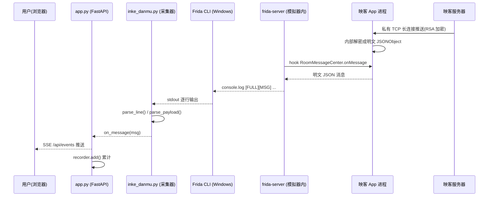

# 映客 APP 逆向实战记录（环境 / 技术 / 架构总览）

本文是 `D:\Scrapy-project\yingke_python` 这个项目的**总说明书**，面向"技术细节不完全熟悉"的读者，尽量用大白话解释每一层在干什么。

目标：从本地 APK `yingke.apk`（映客 `com.meelive.ingkee` 9.9.05）里，把直播间弹幕数据取出来，并最终接到 Web 页面上实时显示。

> 结论先行：
> 1. **脱壳成功**：加固 APK 只看到 5 个类，脱壳后恢复到 33368 个类。
> 2. **协议搞清了**：弹幕走**私有 TCP 长连接 + RSA 加密 + JSON 载荷**，不是常见的 WebSocket/protobuf。
> 3. **采用 Frida hook 拿明文**：不自己实现加密协议，而是在 App 内部"偷看"解密后的消息。
> 4. **Web 端目前只是空壳**：页面有输入框和实时列表，但还没把"输入房间号 → 进房 → 采集 → 显示"这条链路接通。

---

## 第一部分：这个项目到底在解决什么问题

### 1.1 普通网页和原生 App 的区别

你之前做过的 `douyin_python` 是针对**网页**的：网页的 JavaScript 代码可以直接下载下来读，签名函数也可以拿 Node.js 跑一遍。

映客是**原生安卓 App**：
- 核心逻辑被编译成 `dex` 文件（可以理解为"安卓版的程序代码包"）；
- 关键代码还被**加固（加壳）**了，就像给程序代码上了一把锁；
- 弹幕数据走的是 App 自己实现的加密网络协议，不是浏览器那种标准 WebSocket。

所以不能直接"下载 JS 看代码"，必须先解决三件事：

| 顺序 | 要解决的问题 | 用的手段 |
|---|---|---|
| 1 | 代码被加固藏起来了 | 脱壳（从运行中的内存里把原始代码 dump 出来） |
| 2 | 不知道弹幕走什么协议、怎么加密 | 静态反编译 + 运行时 hook |
| 3 | 加密协议复刻成本太高 | 不复刻，直接在 App 里 hook 拿解密后的明文 |

### 1.2 两条技术路线，以及为什么选了第二条

| 路线 | 做法 | 优点 | 缺点 | 本项目是否采用 |
|---|---|---|---|---|
| A. 纯协议复刻 | 自己写 TCP 客户端，复刻 RSA 加密和签名，直连映客服务器 | 不依赖模拟器/App，纯 Python 就能跑 | 要逆向 so 里的加密算法、握手流程、密钥，工作量极大 | **否** |
| B. Frida 动态 hook | 让官方 App 自己跑，在它内部把解密好的消息"截获"出来 | 绕开所有加密，代码量小，拿到的就是明文 JSON | 必须开着模拟器/真机、登录、进直播间 | **是（当前方案）** |

一句话理解路线 B：

> 与其费劲破解保险箱密码，不如等保险箱主人自己打开后，从他手里把里面的东西抄下来。

这也是"必须开模拟器才能获取弹幕"的根本原因。

---

## 第二部分：需要的环境（完整清单）

### 2.1 操作系统与硬件

| 项目 | 实际值 | 说明 |
|---|---|---|
| 宿主系统 | Windows（win32） | 所有工具都跑在这台 Windows 机器上 |
| Shell | PowerShell | 文档里的命令都是 PowerShell 写法 |
| 工作目录 | `D:\Scrapy-project\yingke_python` | 项目根目录 |
| Python | 3.13.13 | 运行采集器、Web 服务、解析脚本 |
| Node.js | v24.16.0 | 早期为"JS 层签名"准备，当前 Frida 方案**未使用** |
| Java（系统 PATH） | 1.8.0_321 | 太旧，不用于 REA；REA 用自己的 JDK |

### 2.2 Android 运行环境：雷电模拟器 9

| 项目 | 实际值 |
|---|---|
| 安装目录 | `D:\leidian\LDPlayer9` |
| 控制台程序 | `D:\leidian\LDPlayer9\ldconsole.exe` |
| 控制台版本 | dnplayer v9.5.39.0 |
| 实例编号 | 0（名称"雷电模拟器"） |
| 安卓版本 | Android 9 / SDK 28 |
| CPU 架构 | x86_64 |
| 当前分辨率 | `1080x1920`，DPI `480`（标准 9:16 手机比例） |
| 配置文件 | `D:\leidian\LDPlayer9\vms\config\leidian0.config` |
| root 模式 | `basicSettings.rootMode: true`（必须） |

**为什么必须 root**：脱壳和 hook 都需要以最高权限读写另一个 App 的内存。普通权限做不到。雷电的 root 开关不在 adb 里，而在上面那个配置文件里，改完必须重启模拟器。

**分辨率踩坑**：之前物理分辨率是 `1440x2560`，但被叠加了一个 `1080x1440`（3:4）的显示覆盖，导致画面不像手机、弹幕区域只显示两行。已用命令永久改为 `1080,1920,480`：

```
ldconsole.exe modify --index 0 --resolution 1080,1920,480
ldconsole.exe reboot --index 0
```

### 2.3 adb（安卓调试桥）

| 项目 | 实际值 |
|---|---|
| 路径 | `C:\Users\Administrator\AppData\Local\Android\Sdk\platform-tools\adb.exe` |
| 作用 | Windows 和模拟器之间的"遥控器"：装 APK、查进程、转发端口、执行 shell 命令 |

常用命令：

```
adb connect 127.0.0.1:5555
adb devices -l
adb -s 127.0.0.1:5555 shell pidof com.meelive.ingkee
adb -s 127.0.0.1:5555 shell "su -c 'id'"
adb -s 127.0.0.1:5555 shell "wm size; wm density"
```

**双设备陷阱**：模拟器同时暴露两个 adb 通道：`127.0.0.1:5555` 和 `emulator-5554`。本项目统一用 `127.0.0.1:5555`，否则后面 Frida 拿到的 PID 命名空间会不一致。

### 2.4 Frida 工具链（动态插桩的核心）

| 组件 | 版本 | 运行位置 | 作用（大白话） |
|---|---|---|---|
| `frida`（Python 包） | 17.19.0 | Windows | 客户端，负责发指令 |
| `frida-tools` | 14.4.0 | Windows | 提供 `frida` / `frida-ps` 命令行 |
| `frida-server` | 17.19.0 android-x86_64 | 模拟器内 `/data/local/tmp/frida-server` | 真正的"注入引擎"，在手机里执行 hook |
| `frida-dexdump` | 2.0.1 | Windows | 从运行中的 App 内存里 dump 出解密后的 dex（脱壳用） |

**版本必须完全一致**：客户端 17.19.0 配 server 17.19.0。之前装了 17.27.0 客户端连不上，用清华 PyPI 镜像降到 17.19.0 才好。

安装命令（pypi.org 直连会 SSL 中断，必须走镜像）：

```
pip install frida==17.19.0 frida-tools==14.4.0 -i https://pypi.tuna.tsinghua.edu.cn/simple
pip install frida-dexdump -i https://pypi.tuna.tsinghua.edu.cn/simple
```

启动 server：

```
adb push frida-server-17.19.0-android-x86_64 /data/local/tmp/frida-server
adb shell chmod 755 /data/local/tmp/frida-server
adb shell "su -c 'nohup /data/local/tmp/frida-server -D >/dev/null 2>&1 &'"
frida-ps -D 127.0.0.1:5555
```

> 注：调试过程中还做过一个改名副本 `/data/local/tmp/.systemui`，用于规避 App 对 `frida-server` 进程名的检测。

### 2.5 静态逆向工具：REA / JADX / JDK

| 组件 | 版本 | 位置 | 作用（大白话） |
|---|---|---|---|
| REA CLI | 6.8.0 | `C:\Users\Administrator\.rea-runtime\bin\rea.cmd` | 逆向分析平台，已注册进 CodeBuddy MCP |
| JADX headless | 0.7.1 | `...\.rea-runtime\tools\jadx-headless-mcp-0.7.1-all.jar` | 把 dex 反编译成人类能读的 Java 代码 |
| JDK | 21.0.13 | `...\.rea-runtime\tools\jdk-21.0.13+9` | 给 JADX 提供 Java 运行环境 |

**REA 的边界（很重要）**：它只做**静态分析**——读文件，不运行 APK。所以面对加固包，它只能看到壳；面对反射、动态加载、so 内部逻辑，它也看不到。它给的是"线索"，不是"最终答案"。

### 2.6 Python Web 侧依赖

`requirements.txt` 内容：

```
curl_cffi>=0.11      # 模拟浏览器 TLS 指纹（douyin 骨架遗留，本项目未使用）
websockets>=13       # WebSocket 客户端（骨架遗留，映客不是 WS，未使用）
protobuf>=5          # protobuf 编解码（骨架遗留，映客用 JSON，未使用）
fastapi>=0.115       # Web 框架，提供 HTTP 接口和 SSE
uvicorn>=0.30        # ASGI 服务器，跑 FastAPI
python-multipart>=0.0.12
```

**真正被当前方案用到的只有 `fastapi` + `uvicorn`**。前三个是从 douyin 项目继承的占位依赖，看到不要困惑。

启动 Web 服务：

```
cd D:\Scrapy-project\yingke_python
python -m uvicorn app:app --host 127.0.0.1 --port 8801
```

也可以双击 `启动弹幕GUI.bat`，然后浏览器打开 `http://127.0.0.1:8801`。

---

## 第三部分：用到的外部框架、程序、技术（逐个解释）

### 3.1 加固与脱壳

- **加固（加壳）**：把真正的程序代码加密后藏起来，外面只留一层"壳"。映客的特征是类名 `s.h.e.l.l.*` 和 `assets/ijm_lib/`，判断为**爱加密（IJMedia）**。
- **dex**：安卓 App 的代码打包格式，类似 Windows 的 `.dll`。
- **脱壳**：让 App 正常运行，它自己会把代码解密到内存里，这时用 `frida-dexdump` 把内存中的 dex 拷贝出来。
- **重组 APK**：REA 只接受完整 APK，不接受一堆散 dex。所以用脚本把 41 个去重后的 dex 塞回原 APK 的资源包，生成 `reverse/unpacked.apk`。

### 3.2 私有 TCP 长连接 + RSA + JSON

- **长连接**：App 和服务器建立一条 TCP 连接后一直不断开，服务器有消息就推过来。弹幕就是这么来的。
- **私有协议**：映客自己定义的包格式和命令字，不是公开的 WebSocket 标准。
- **RSA 加密**：非对称加密算法，这里用于保护长连接数据。密钥逻辑在 `tech.appshatcher.comm.conn.core.rsa.InKeRsaManager`。
- **JSON 载荷**：最终消息内容是普通 JSON，例如：

```json
{
  "b": {"ev": "s.m"},
  "liveid": "1794990808814964",
  "ms": [
    {
      "tp": "chat",
      "c": "来啦来啦[say hi][庆祝]",
      "from": {"nic": "心碎过的女生", "id": 779248897}
    }
  ]
}
```

### 3.3 Frida 动态插桩

- **hook**：在程序运行过程中，把某个函数"换成"我们自己的实现，从而看到它的参数、返回值，甚至改写行为。
- **attach 模式**：等 App 已经跑起来，再挂上去。本项目必须用这个模式——spawn（启动即注入）会被加固反调试杀掉。
- **反反调试**：爱加密检测到 Frida 后会调用 `kill` / `exit` / `System.exit` 自杀。`rpc_full.js` 里把这些出口全拦下来。
- **device 通道 vs host 通道**：`-D 127.0.0.1:5555` 是 device 通道，PID 和 adb 一致；`-H 127.0.0.1:27042` 是 host 通道，看到的是另一套 PID 空间，会报 "No such process"。**必须用 `-D`**。

### 3.4 FastAPI + SSE（Web 端）

- **FastAPI**：Python 的 Web 框架，负责提供 `/api/start`、`/api/stop`、`/api/events` 等接口。
- **SSE（Server-Sent Events）**：服务器主动往浏览器推消息的技术。浏览器用 `EventSource` 连上 `/api/events`，后端每来一条弹幕就推一条，前端实时追加到列表。
- **CSV 导出**：`recorder.py` 把一次会话的消息存成 `exports/inke_*.csv`。

### 3.5 关键类地图（反编译出来的）

| 类名 | 作用 |
|---|---|
| `com.meelive.ingkee.business.room.connection.RoomMessageCenter` | **消息总入口**，hook 的就是它的 `onMessage` |
| `RoomMessageCenter$RoomConnMessage` | 消息封装对象，内部有 `data:JSONObject` 和 `event:String` |
| `tech.appshatcher.comm.facade.InKeConnClient` | 长连接门面类 |
| `tech.appshatcher.comm.conn.tcp_channel.TcpChannelFactory` | TCP 通道工厂 |
| `tech.appshatcher.comm.conn.core.rsa.InKeRsaManager` | RSA 加密管理 |
| `tech.appshatcher.iknetworksigner.IKSecureSignInterceptor` | HTTP 请求签名拦截器 |

---

## 第四部分：整体链路架构图

### 4.1 全流程总览



### 4.2 运行时数据链路（实际抓弹幕时）



### 4.3 单机视角的分层图（ASCII）

```
┌─────────────────────────── Windows 主机 ───────────────────────────┐
│                                                                    │
│  ┌──────────────┐   HTTP/SSE   ┌──────────────┐   stdout    ┌──────┐ │
│  │ 浏览器 8801  │◄─────────────►│  app.py      │◄────────────│inke_ │ │
│  │ index.html   │              │  FastAPI     │  callback   │danmu │ │
│  └──────────────┘              └──────┬───────┘             │.py   │ │
│                                       │                     └──┬───┘ │
│                                       │                        │     │
│                              ┌────────▼───────┐                │     │
│                              │ recorder.py    │                │     │
│                              │ exports/*.csv  │                │     │
│                              └────────────────┘                │     │
│                                                                │     │
│  ┌───────────────────┐                                ┌────────▼───┐ │
│  │ 静态分析工具      │                                │ frida CLI  │ │
│  │ REA / JADX / JDK  │                                │ -D 5555    │ │
│  └────────┬──────────┘                                └────────┬───┘ │
│           │ 分析 unpacked.apk                                  │     │
└───────────┼──────────────────────────────────────────────────┼─────┘
            │                                                  │ adb/frida 通道
┌───────────▼─────────────── 雷电模拟器 9 ─────────────────────▼─────┐
│  Android 9 / x86_64 / 1080x1920 / 480dpi / root 已开启             │
│                                                                    │
│  ┌─────────────────┐        ┌──────────────────────────────────┐    │
│  │ frida-server    │◄──────►│ 映客 App com.meelive.ingkee      │    │
│  │ /data/local/tmp │  hook  │ RoomMessageCenter.onMessage()    │    │
│  └─────────────────┘        └───────────────┬──────────────────┘    │
│                                             │ 私有 TCP + RSA        │
└─────────────────────────────────────────────┼──────────────────────┘
                                              │
                                      ┌───────▼────────┐
                                      │ 映客服务器     │
                                      └────────────────┘
```

---

## 第五部分：完整过程还原（按顺序）

### 步骤 1：静态分析发现"壳"

对原始 `yingke.apk` 调用 REA：

```
inspect_android_package(path=yingke.apk, detail=summary)
search_android_classes(path=yingke.apk, query="")
```

**观察结果**：
- 包名 `com.meelive.ingkee`，versionName `9.9.05`，versionCode `9920`。
- SHA-256 `5974d43b003812af8989536f8bad98b6a9e68daa17f70ad9c2a70f841d25c749`。
- 全量类清单**只有 5 个**：`com.meelive.ingkee.R`、`s.h.e.l.l.A`、`s.h.e.l.l.C`、`s.h.e.l.l.N`、`s.h.e.l.l.S`。
- 搜 `danmu` / `barrage` / `chat` / `comment` 全部 0 匹配。
- ZIP 里有 `assets/ijm_lib/{arm64-v8a,x86_64}/libexec.so` 等。

**判断**：爱加密加固。真实代码运行时才解密，必须先脱壳。

### 步骤 2：搭建脱壳环境

1. 启动模拟器：`ldconsole.exe launch --index 0`
2. 开 root：改 `leidian0.config` 的 `basicSettings.rootMode` 为 `true`，重启，验证 `su -c id` 得到 `uid=0(root)`。
3. 装 Frida 工具链（版本必须一致，走清华镜像）。
4. 推送并启动 frida-server，用 `frida-ps -D 127.0.0.1:5555` 验证。

### 步骤 3：脱壳

1. 安装 APK：`adb install -r yingke.apk`
2. 启动 App，进入直播间。
3. **spawn 模式失败**：`frida-dexdump -f` 会被反调试杀掉（`script has been destroyed`）。
4. 改用 **attach**：

```
frida-dexdump -H 127.0.0.1:27042 -p <PID> -o reverse\unpacked -d
```

5. dump 出 42 个 dex，按 MD5 去重得 41 个。
6. 用脚本重组为 `reverse\unpacked.apk`（181MB）。

### 步骤 4：用 REA 定位接口候选

对 `unpacked.apk` 重新分析，类数量从 5 → **33368**，脱壳成功。

| 关键词 | 命中的关键类 |
|---|---|
| `danmu` | `com.meelive.ingkee.business.game.live.danmuku.*` |
| `barrage` | `BarrageManager`、`BarragePushModel` |
| `ChatMessage` | `IMChatMessage*`、`ChatMessage` |
| `conn` | `RoomMessageCenter`、`RoomConnectionManager`、`tech.appshatcher.comm.conn.*` |

深挖结论：`RoomMessageCenter.onMessage(RoomConnMessage)` 是消息入口，`watchRoomMessage(String)` 设置房间号；消息载荷是 `org.json.JSONObject`，说明是 JSON 不是 protobuf。

### 步骤 5：Frida hook 拿明文

关键脚本 `reverse/hooks/rpc_full.js` 做三件事：

1. **反反调试**：拦截 native `kill`、`exit`、`android.os.Process.killProcess`、`java.lang.System.exit`。
2. **hook 弹幕入口**：替换 `RoomMessageCenter.onMessage`，读取 `m.data.value.toString()` 和 `m.event.value`，放进队列。
3. **自动 dump**：每 3 秒把队列里的消息打印成 `[FULL][MSG] <event> | <json>`。

运行命令：

```
adb -s 127.0.0.1:5555 shell pidof com.meelive.ingkee
frida -D 127.0.0.1:5555 -p <PID> -l reverse\hooks\rpc_full.js
```

**实测成功**：抓到 65 条消息，包含真实用户发言 `来啦来啦[say hi][庆祝]`（用户"心碎过的女生"），以及进场、点赞、礼物、守护、系统公告等。样本在 `reverse/hooks/login_capture.log`、`final_capture.log`。

### 步骤 6：Python 解析

`inke_danmu.py` 负责把 hook 日志变成结构化消息：

- `MSG_RE` 正则匹配 `[FULL][MSG] ... | {json}`
- `parse_payload()` 遍历 `ms[]`，按 `tp` 字段映射成类别：

| tp | 类别 |
|---|---|
| `chat` | 弹幕 |
| `user_join_tip` / `color` | 进场 |
| `usernu` | 人数 |
| `gift_refine_sync_state` | 礼物 |
| `doubleclickcount` | 点赞 |
| `float_public_chat_v2` | 飘屏 |
| `guard_seat_info_update` | 守护 |
| `sys` | 系统 |

- `InkeDanmu` 类启动 frida CLI 子进程，内部线程读 stdout 并回调。

**已修复的坑**：hook 日志原来把 JSON 截断到 1500 字符，导致 chat 消息被切掉后解析失败。现在输出完整 JSON。

### 步骤 7：Web 端（当前状态）

`app.py` 提供 `/api/start`、`/api/stop`、`/api/events`（SSE）、`/api/status`、`/api/export`、`/api/history` 等接口；`static/index.html` 有房间号输入框、分类过滤、实时列表、CSV 导出按钮。

**但链路还没接通**，具体缺三点：

1. `/api/start` 只把房间号存起来，没有传给采集器，也没有让 App 进入该直播间。
2. `inke_danmu.py` 返回的消息没有 `kind: "danmu"` 字段，而前端只显示 `kind === 'danmu'`，所以抓到了也不显示。
3. `/api/stop` 调用 `client.running = False`，但 `InkeDanmu` 没有这个属性，应该调 `client.stop()`。

---

## 第六部分：现在到底能用成什么样

### 6.1 已经能用的

- 模拟器开 root、正常分辨率、登录映客、进直播间。
- Frida server 运行，`frida -D ... -p PID -l rpc_full.js` 能稳定抓到明文 JSON。
- `inke_danmu.py` 能解析日志，`python inke_danmu.py` 自检 `SELFTEST PASS`。
- `python tests/selftest.py` 通过。
- Web 服务能启动，页面能打开，SSE 通道能连。

### 6.2 还不能用的

- **Web 端输入房间号自动进房并采集** —— 未实现。
- **不依赖模拟器、纯 Python 直连服务器** —— 未实现（需要复刻私有 TCP + RSA）。

### 6.3 最小依赖链（当前方案）

```
模拟器开机 → 映客登录并进入直播间 → frida-server 运行
→ Web 端 attach 当前 PID → 解析 → SSE 显示
```

缺任何一环都拿不到弹幕。

---

## 第七部分：启动命令速查

完整跑一次采集：

```
# 1. 确认模拟器与分辨率
D:\leidian\LDPlayer9\ldconsole.exe list2
D:\leidian\LDPlayer9\ldconsole.exe modify --index 0 --resolution 1080,1920,480
D:\leidian\LDPlayer9\ldconsole.exe reboot --index 0

# 2. adb 连接
adb connect 127.0.0.1:5555
adb -s 127.0.0.1:5555 shell "wm size; wm density"

# 3. 启动 frida-server（模拟器内）
adb -s 127.0.0.1:5555 shell "su -c 'nohup /data/local/tmp/frida-server -D >/dev/null 2>&1 &'"

# 4. 打开映客，手动进入直播间，然后拿 PID
adb -s 127.0.0.1:5555 shell pidof com.meelive.ingkee

# 5. 挂 hook（换成上一步的 PID）
frida -D 127.0.0.1:5555 -p <PID> -l D:\Scrapy-project\yingke_python\reverse\hooks\rpc_full.js

# 6. 另开一个终端启动 Web
cd D:\Scrapy-project\yingke_python
python -m uvicorn app:app --host 127.0.0.1 --port 8801
```

浏览器打开 `http://127.0.0.1:8801`。注意：页面上的"连接"按钮目前不会让 App 进房，需要你已经在模拟器里进好直播间。

---

## 第八部分：产物清单

| 文件 | 说明 |
|---|---|
| `yingke.apk` | 原始加固样本（119MB） |
| `reverse/unpacked.apk` | 脱壳后重组的 APK（181MB），可用 REA 继续分析 |
| `reverse/unpacked/*.dex` | dump 出的 42 个 dex（去重后 41 个） |
| `reverse/hooks/rpc_full.js` | **最终 hook 脚本**（反反调试 + 弹幕 hook + 自动 dump） |
| `reverse/hooks/rpc_spawn.js` | spawn 模式备选（含更完整的反退出 hook，未成功） |
| `reverse/hooks/hook_inke2.js` / `hook_net.js` / `hook_gateway.js` | 分析过程中的探测脚本 |
| `reverse/hooks/final_capture.log` | 最终实测抓包（40+ 条完整 JSON） |
| `reverse/hooks/login_capture.log` | 登录状态下实测抓包（65 条，含真实 chat 样本） |
| `inke_danmu.py` | 实时弹幕提取器（协议解析 + frida CLI 采集） |
| `app.py` | FastAPI Web 服务 + SSE |
| `static/index.html` | Web 页面（输入框、分类过滤、实时列表、导出） |
| `recorder.py` | 会话录制与 CSV 导出 |
| `category.py` | 消息类别定义 |
| `tests/selftest.py` | 不依赖网络的自检 |
| `协议与接口_最终报告.md` | 协议格式与 hook 方案详报 |
| `reverse/rea_notes.md` | REA 静态分析记录 |

---

## 第九部分：踩坑总结（重要）

1. **加固识别**：类只有个位数 + `s.h.e.l.l.*` / `ijm_lib` → 爱加密。
2. **雷电 root 开关**在 `vms/config/leidian0.config` 的 `basicSettings.rootMode`，改后必须 reboot。
3. **分辨率异常**：`wm size` 有 Override 时要 `wm size reset`，或直接用 `ldconsole modify` 永久设成 `1080,1920,480`。
4. **frida 版本必须一致**：客户端与 server 都 17.19.0；下载被墙时用本机已有 server 或清华镜像。
5. **spawn 会被反调试杀**，优先 attach 已运行的进程。
6. **进程名中文乱码**：不能用进程名 attach，用 `pidof` 拿 PID。
7. **Frida 双通道**：必须用 `-D 127.0.0.1:5555`；`-H 127.0.0.1:27042` 的 PID 空间不一致。
8. **REA 不吃裸 dex**：要把 dex 重组回 APK 结构。
9. **JSON 截断**：hook 日志不能截断，否则 chat 消息解析失败。
10. **App 偶发自杀**：反复 force-stop + attach 会让加固残留清理杀进程，保持一个稳定进程再 attach 成功率最高。
11. **静态分析纪律**：反编译是静态观察，不代表运行时行为；最终结论必须靠动态验证。

---

## 第十部分：纯接口方案可行性验证（最小试探，2026-11-18）

### 10.1 验证目标

不依赖模拟器直连服务器，需要先拿到 5 个未知项（见前面分析）。本次按"从最简单开始"的原则，只验证其中**最容易的一个**：

> **网关地址（host:port）是否明文可见？**

如果可见，纯接口方案可继续；如果不可见，说明需要啃 so 逆向，成本陡增。

### 10.2 之前为什么没抓到（根因复盘）

`reverse/hooks/gw.log`、`gw3.log` 等历史网关脚本**全部失败**，根因有二：

1. 用了 `-H 127.0.0.1:27042`（host 通道），看到的是另一套 PID 空间 → `No such process` / `unable to write to process memory`。
2. 脚本没带反反调试，App 检测到 Frida 后自杀。

本次全部改用 **device 通道 `-D 127.0.0.1:5555`** 并内置反反调试。

### 10.3 尝试过程（按顺序）

**尝试 1：`probe_gateway_min.js`（功能较全）**

- hook 内容：Builder 全部方法、InKeConnClient/RSA 方法签名、native connect、全量类扫描。
- 结果：
  - 拿到了完整方法签名（有价值的静态情报，见下）；
  - `connect` hook 报错 `TypeError: not a function`（`Module.findExportByName('libc.so',...)` 写法在 Frida 17 不适用）；
  - `Java.enumerateLoadedClasses` 全量扫描导致 `Failed to load script: timeout was reached`。
- 日志：`reverse/hooks/probe_gw1.log`

**尝试 2：精简掉全量扫描，修正坐标进房**

- 结果：App 卡死（ANR）。判断是批量 hook 方法过多（RSA 遍历 + Builder 遍历）导致。
- 日志：`reverse/hooks/probe_gw2.log`

**尝试 3：`probe_gateway_v2.js`（极简，只 hook Builder + native connect）**

- 修正：`Module.getExportByName` / `Process.getModuleByName(...).getExportByName` 多方式兜底。
- 结果（稳定会话下完整加载）：
  ```
  [GW2][ANTI] ok
  [GW2][CONNECT_ADDR] 0x7639172ae390
  [GW2][CONNECT_HOOK] ok
  [GW2][BUILDER_HOOK] ok
  [GW2][READY] v2 installed
  ```
  hook 全部生效，但**进房后没有触发任何 `CONNECT` 或 `B.*` 事件**。
- 日志：`reverse/hooks/probe_gw_final.log`

**尝试 4：`probe_connect_spawn.js`（spawn 抓启动瞬间）**

- 思路：既然进房不新建连接，连接应该是 App 启动时建立的单例 → 用 spawn 在启动瞬间抓。native connect hook 不依赖 dex，不受"脱壳类未加载"影响。
- 结果：hook 装上了，但 `Process terminated`（反调试杀进程），且没抓到任何 TCP 地址。
- 日志：`reverse/hooks/probe_spawn.log`

### 10.4 本次拿到的静态情报（观察）

从 `probe_gw1.log` 得到的方法签名：

```
InKeConnClient$Builder:
  a(Builder) b(Builder) c(Builder) d(Builder) e(Builder) f(Builder) g(Builder) h(Builder)
  i() j(c) k(b) l(d) m(k) n(b) o(boolean)

InKeConnClient:
  a() b() c() d() e() f() g() h(a) i() j(d) k() l(b,b) m(String,b) n(String,b) o(String,b)

InKeRsaManager:
  a(c) b() c() encrypt(byte[])
  字段 a=null（运行时才初始化）
```

`Builder.j~o` 的参数类型 `c/b/d/k/boolean` 是混淆后的内部类，这些 setter 很可能就是配置 host/port/token 的地方，但本次没触发到。

### 10.5 结论（对纯接口方案的判断）

| 问题 | 答案 | 依据 |
|---|---|---|
| 进房时是否新建 TCP 连接？ | 否 | 尝试 3：稳定 hook 后进房无任何 connect / Builder 调用 |
| 网关地址是否明文可见？ | **本次未拿到** | native connect hook 未捕获；Builder setter 未触发 |
| App 用什么建连？ | 推测：native socket 或 Netty epoll，不走 libc `connect` 常规路径 | 尝试 3+4 均未触发 libc connect |
| 纯接口方案可行性 | **难度上调，但未否定** | 还需更深入的 hook 或 so 逆向 |

**关键判断**：

1. 这次是**阴性结果**（没抓到地址），但排除了"进房时动态建连"这个最简单假设。
2. 连接是 App 启动阶段的单例，且可能走 native 层。要拿到网关地址，下一步必须：
   - hook `InKeConnClient` 的静态初始化 / Builder 构造（在 App 启动时，需要解决 spawn 被杀的问题）；或
   - 用 Ghidra 逆向 so 找网关下发逻辑；或
   - 抓 HTTP 接口看网关是否由服务端下发（需要 mitmproxy + 过证书锁定）。
3. 这三条都不再是"最简单"的范畴，符合上一轮评估——纯接口是独立的中大型工程。

### 10.6 建议的下一步（按投入产出排序）

1. **先修 Web 端断链**（投入最小、立竿见影）：补 `kind` 字段、修停止逻辑、房间号传参，让当前 hook 版真正可用。
2. **再考虑纯接口**：若仍要做，从"抓 HTTP 进房接口"入手（阶段 A），用 mitmproxy + objection 过证书锁定，看网关是否明文下发——这是比 hook native 更低风险的入口。

### 10.7 本次新增/修改的文件

| 文件 | 说明 |
|---|---|
| `reverse/hooks/probe_gateway_min.js` | 较全的网关探测（因 ANR/超时弃用，保留作参考） |
| `reverse/hooks/probe_gateway_v2.js` | 极简版，只 hook Builder + native connect（**本次主用**） |
| `reverse/hooks/probe_connect_spawn.js` | spawn 模式抓启动瞬间 connect |
| `reverse/hooks/probe_gw1.log` ~ `probe_gw_final.log` | 各次尝试的日志 |
| `reverse/hooks/probe_spawn.log` | spawn 尝试日志 |

### 10.8 第二轮：抓 HTTP 进房接口（同日续）

目标：走"阶段 A"路线，看进房接口是否明文下发网关地址。选了一条**比 mitmproxy 更轻**的路子——Frida hook OkHttp 拦截器，直接拿 Java 层明文 URL（不需要过证书锁定）。

**关键发现：映客不用标准 OkHttp。**

- hook `okhttp3.OkHttpClient` → `ClassNotFoundException`，说明它用的是**自研/混淆的网络栈**（结合前面的 `tech.appshatcher.comm.*`，这套通信SDK是自己实现的）。
- 但 `tech.appshatcher.iknetworksigner.IKSecureSignInterceptor.intercept(a)` 能 hook 到——这是它 HTTP 栈的签名拦截器，参数类型 `a` 是混淆的 Chain 类。

**尝试与结果：**

| 脚本 | 做法 | 结果 |
|---|---|---|
| `probe_http.js` | hook `IKSecureSignInterceptor.intercept`，打 Response | **成功**（唯一稳定成功的一次），抓到 22 条明文 URL |
| `probe_http_all.js` | 全覆盖 OkHttp + 读 body | App 崩溃（怀疑读 `body.string()` 破坏了 App 只能读一次的限制） |
| `probe_urls_safe.js` | 只 hook newCall | `okhttp3.OkHttpClient` 类不存在，失败 |
| `probe_http_v2.js` | 反射 Chain 方法 + `Response.request().url()` | 反复 attach 后 App 进入持续反制，一挂就死 |

**抓到的 22 条 URL 分析（`analyze_urls.py`，日志 `probe_http1.log`）：**

```
 2  serviceinfo.inke.cn/time/getconfig     ← 配置/时间接口（可疑）
20  maidian.inke.cn/log/* 与 /upload/*     ← 埋点上报（无用）
```

**结论：**

1. `IKSecureSignInterceptor` **只覆盖埋点和配置类请求**，没有进房接口、没有网关地址。
2. `serviceinfo.inke.cn/time/getconfig` 是唯一值得深挖的接口——配置下发类接口通常可能带网关地址，但本次只看了 URL，没读它的 Response body（读 body 的脚本会崩）。
3. 纯接口方案的难度再次上调：进房/弹幕走的是**完全自研的网络栈**，不在标准 OkHttp 拦截链路里，hook 面更窄。

**环境副作用（重要）：**

反复 force-stop + attach 触发了爱加固的累积反制，App 进入"一 attach 就自杀"状态。中途**重启模拟器两次**才恢复；最终 `probe_http.js` 再挂时仍失败，判断是加固进程残留清理机制（已知坑 10）在持续生效。建议后续实验：每次 hook 前先 `reboot` 模拟器，用干净环境的一次性窗口。

**下一步建议（按优先级）：**

1. **先修 Web 端断链**（补 `kind` 字段、修停止逻辑、房间号传参）——投入最小、立竿见影，让当前 hook 版真正可用。
2. 若继续纯接口：读 `serviceinfo.inke.cn/time/getconfig` 的 Response（用 OkHttp 的 `peekBody()` 或 hook `ResponseBody` 构造，避免破坏 App），看是否含网关配置。
3. 或改用 mitmproxy 全局抓包（本机当前未装），从网络层覆盖自研栈——但要过证书锁定，成本更高。

**本轮新增文件：**

| 文件 | 说明 |
|---|---|
| `reverse/hooks/probe_http.js` | hook 签名拦截器拿明文 Response（**唯一成功**） |
| `reverse/hooks/probe_http_all.js` / `probe_urls_safe.js` / `probe_http_v2.js` | 其他尝试脚本（因崩溃/类不存在/反制失败） |
| `reverse/hooks/probe_http1.log` | 成功抓到的 22 条 URL（分析依据） |
| `reverse/hooks/analyze_urls.py` | URL 分析脚本（提取唯一域名+路径） |

---

## 第十一部分：GitHub 开源项目调研与纯接口突破（2026-11-18 续）

### 11.1 调研的开源项目

按用户要求到 GitHub 找逆向相关开源项目学习，找到两个高价值项目：

| 项目 | 地址 | 价值 |
|---|---|---|
| **iyear/pure-live-core** | `github.com/iyear/pure-live-core` | **有现成的 Inke 映客客户端**，明确支持弹幕订阅 |
| renzhidao/pure_live | `github.com/renzhidao/pure_live` | 映客公开接口审计文档（`INKE_PUBLIC_CONTRACT_AUDIT`） |

其他参考：CSDN 的映客 websocket 抓包文章（确认了 `s.m` + `ms[]` + `tp` 格式与我们 Frida hook 到的完全一致）、BarrageGrab（弹幕抓取架构）。

**网络限制**：本地 git/urllib 访问 GitHub/raw 全部 SSL 握手失败（与之前下载 frida-server 同样的网络问题），最终通过 `web_fetch` 工具成功读取到源码原文。

### 11.2 从 pure-live-core 学到的关键情报（逐字源码）

`pkg/client/internal/inke/util.go`：
```go
func getRoomInfo(room string) (gjson.Result, error) {
    err := request.HTTP().
        GET(fmt.Sprintf("https://webapi.busi.inke.cn/web/live_share_pc?uid=%s", room)).
        BindBody(&body).Do()
    ...
}
```

`pkg/client/internal/inke/base.go`：
```go
func (i *Inke) Host(room string) string {
    info, err := getRoomInfo(room)
    return info.Get("data.sio_url").String()   // WS 地址在 sio_url 字段
}
func (i *Inke) HeartBeat() (int, []byte, error) { return 0, nil, conf.ErrSkip }  // 无需心跳
func (i *Inke) Enter(room string) (int, [][]byte, error) { return 0, nil, conf.ErrSkip } // 无需进房命令
func (i *Inke) Handle(tp int, data []byte) ([]model.Msg, bool, error) {
    j := gjson.Parse(string(data))
    if j.Get("b.ev").String() != "s.m" { return nil, false, nil }
    for _, msg := range j.Get("ms").Array() {
        if msg.Get("tp").String() == "pub" {   // 只处理 pub 类型弹幕
            for _, t := range msg.Get("statement_info").Array() {
                content := t.Get("c").String()  // 弹幕内容
                color := t.Get("c_color").String()[1:]  // 颜色
            }
        }
    }
}
```

**核心结论**：映客弹幕是**标准 WebSocket**，协议极简——**无需心跳、无需进房命令、无需登录**，连上就推。消息格式 `{"b":{"ev":"s.m"},"ms":[{"tp":"pub","statement_info":[{"c":"弹幕内容"}]}]}`，与我们 Frida hook 到的 App 数据**同构**。这是纯接口方案的重大突破口。

### 11.3 本地实测：公开接口全部可用（不依赖模拟器）

新增验证脚本（均在 `reverse/references/`）：

| 脚本 | 验证内容 | 结果 |
|---|---|---|
| `test_inke_web.py` | `Live_top_pc` 精选列表 | 成功，返回在线房间含 `uid`/`live_id` |
| `test_get_socket_url.py` | `chatroom.inke.cn/url` 拿 WS 地址 | **成功**，返回 `wss://chatroom.inke.cn/ws?...&sec=...` |

实测拿到的房间样例：`liveid=1795004103423719 uid=771687341 nick=加薪饼干`。

**重要接口清单**（本地实测可用）：
```
GET https://webapi.busi.inke.cn/web/Live_top_pc                 → 在线房间列表
GET https://webapi.busi.inke.cn/web/live_share_pc?uid=<UID>     → 房间详情（liveid/status/live_name）
GET https://chatroom.inke.cn/url?roomid=<liveid>&uid=<live_uid>&id=<liveid>&access_from=pc_web
                                                                → WebSocket 地址（含 sec 签名）
```

房间脚本路径（前端 JS，用于逆向连接逻辑）：
```
https://webcdn.inke.cn/www.inke.cn.live/static/js/liveroom.www.a6740050e.chunk.js
```
从 JS 中逆向出连接代码：`getSoketUrl({roomid,uid,id,access_from})` → `new WebSocket(r.url)` → `onmessage(JSON.parse)`。

### 11.4 接口变更：sio_url 已下线

pure-live-core（2025-04 的代码）从 `live_share_pc` 的 `data.sio_url` 取 socket.io 地址。但**现网已变更**：实测 `live_share_pc` 返回的字段为
```
media_info, records, status, portrait, liveid, live_uid, is_follow,
live_type, sub_live_type, live_name
```
**没有 `sio_url`**。现在改为通过 `chatroom.inke.cn/url` 单独获取原生 `wss://` 地址（socket.io 端点 `/socket.io/` 已 404 下线）。所以不能照抄开源项目，需要适配新接口。

### 11.5 卡点：WebSocket 握手返回 invalid parameters（未解决）

拿到 wss 地址后，用多种客户端尝试握手**全部失败**：

| 客户端 | 结果 |
|---|---|
| Python `websocket-client` | `Handshake status 200 OK ... invalid parameters` |
| Node 24 内置 `WebSocket` | `CLOSE 1006` |
| Python curl_cffi（拿 URL 成功） | 不支持 WS 升级 |

**已排除的原因**：
- 出口 IP（本机 `112.7.152.146` 与 URL 中 `xrealip` 一致）✓
- Cookie（`INKE_UUID`）✓
- 各种 header 组合（Origin/Referer/UA）✓
- 参数去重、去空、去 xrealip、逐个删除参数 ✓
- access_from 取值（pc_web/web/pc/h5/app）✓
- socket.io 端点（404）✓

**最可能根因（推断）**：`sec` 签名或服务器校验绑定了 **TLS 指纹（JA3）**——curl_cffi 模拟 Chrome TLS 能拿到 URL，但 websocket-client / Node 用的是各自的 TLS 指纹，被服务器在握手阶段拒绝。这是需要继续攻克的点。

### 11.6 下一步建议

1. **用 TLS 指纹伪装的 WS 客户端**：如 Go 的 `gorilla/websocket` + `utls`（pure-live-core 用的就是 gorilla，能连老 socket.io）；或 Python 的 `websocket-client` 配合 curl_cffi 的 SSL context；或 `curl_cffi` 升级握手后手动实现 WS 帧收发。
2. **用 real browser 验证**：通过 CDP/Playwright 打开房间页，确认真实浏览器 WS 帧，再对比我们客户端的差异。
3. **逆向 sec 签名**：若握手必须匹配指纹，可 hook 前端 JS 的签名函数（`new-cn.js`），理解 sec 的生成规则。
4. 若打通 WS，则可做一个**纯 Python 的 Web 弹幕采集器**，彻底摆脱模拟器——这是当前最有希望的路线。

### 11.7 本轮新增文件

| 文件 | 说明 |
|---|---|
| `reverse/references/test_inke_web.py` | 验证精选接口，拿房间 uid/live_id |
| `reverse/references/test_get_socket_url.py` | 验证 chatroom.inke.cn/url 拿 WS 地址（**成功**） |
| `reverse/references/find_ws_url.py` / `dig_chatroom*.py` / `find_concat.py` | 逆向前端 JS 找 WS 连接逻辑 |
| `reverse/references/dig_socket_api.py` | 定位 getSoketUrl 接口路径 |
| `reverse/references/test_ws_*.py` / `test_socketio.py` / `test_ws_node.js` | WS 握手尝试（均因 invalid parameters 失败） |
| `reverse/references/test_ws_ip.py` | 诊断出口 IP 与 xrealip |
| `test_sio_url.py` | 验证 sio_url 字段（已下线） |

---

## 第十二部分：WS 握手攻坚（gorilla/utls 路线与排除法，2026-11-18 续）

### 12.1 目标与思路

承接第十一部分，继续攻克"拿到 wss 地址后握手返回 `invalid parameters`"的问题。用户要求用 Python 方式并参考 `jd-captcha-reverse` skill 的指纹对抗资料。

skill 的关键情报：**curl_cffi 的 `impersonate="chrome"` 已让 JA4/H2 指纹与真 Chrome 一致**（JdApis 项目实测），换 curl_cffi 通常是为了减少 Python 特征而非修 403。这提示：如果 TLS 指纹是问题，用 curl_cffi 就该成功。

### 12.2 逐层排除实验（关键）

| 实验 | 脚本 | 结果 | 排除的假设 |
|---|---|---|---|
| curl_cffi Chrome TLS 发 WS 升级请求 | `test_curl_ws_upgrade.py` | `200 invalid parameters` | **TLS/JA3 指纹**（Chrome 指纹也失败） |
| 同一 Session（cookie + Chrome TLS） | `test_curl_ws_session.py` | `200 invalid parameters` | Cookie（INKE_UUID）、会话绑定 |
| 完全原样 URL（不 parse 重组） | `test_ws_rawurl.py` | 失败，原样==重组 | URL 编码二次处理 |
| 原始 socket + ssl 强制 ALPN=http/1.1 手写握手 | `test_ws_rawsocket.py` | `HTTP/1.1 200 OK`, `Connection: keep-alive` | HTTP/2 问题、库层差异、header 顺序 |
| 穷举 roomid/id/uid 参数组合（5 种） | `test_ws_param_combo.py` | 全部 invalid | 参数传错（liveid vs uid） |
| 逐参数删除 | `test_ws_params.py` | 删任何参数都失败 | 某个冗余参数导致校验失败 |
| 出口 IP 对比 | `test_ws_ip.py` | 本机 `112.7.152.146` == URL 的 xrealip | IP 绑定不一致 |
| sec 签名构成分析 | `analyze_sec.py` | 常见 MD5/SHA 组合+Salt 均不匹配 | sec 是服务端密钥签名，无法本地构造 |

**结论**：客户端侧所有变量（TLS 指纹、Cookie、header、HTTP 版本、URL 编码、参数、IP）全部排除。

### 12.3 决定性实验：真实浏览器也连不上

用 jshook MCP 的 Chrome 157 打开在线房间页，通过 `page_evaluate` 在**浏览器页面上下文内**执行：

```js
const d = await fetch('https://chatroom.inke.cn/url?...').then(r=>r.json());
const ws = new WebSocket(d.url);  // 用浏览器自己的 WebSocket
```

结果：`{"result":"ERROR","open":false}` —— **真实 Chrome 用页面自己拿到的 URL 也连不上**。

这是决定性的：问题不在 Python 客户端，也不在 TLS 指纹，而是这个 wss URL **对当前匿名上下文无效**。

### 12.4 前端 JS 逻辑复核（确认不是协议理解错）

从新版房间页实际加载的 JS（`liveroom.www.a6740050e.chunk.js`，当前仍在使用）复核：

```js
// 1) 连接逻辑：getSoketUrl 返回 url 后直接 new WebSocket
nt.a.getSoketUrl({roomid:n.liveid, uid:n.live_uid, id:n.liveid, access_from:"pc_web"})
  → r → this.ws = new Ln("".concat(r.url))
  → addEventListener("message", e => onMessage(JSON.parse(e.data)))

// 2) getSoketUrl 定义：p("/url", _)，root = https://chatroom.inke.cn
//    _ = {codeKey:"dm_error", successCode:0}

// 3) 老字段 sio_url 的处理（已下线）：
l = r.sio_url ? r.sio_url.replace(j, "ws" + protocol + "//") : ""
```

协议理解无误。且 socket.io 端点 `/socket.io/` 实测已 404 下线。

### 12.5 根因判断

综合所有证据，最可能的根因是：

> **匿名访问时 `/url` 返回的 wss URL 中 `token=`、`sid=` 为空，WebSocket 服务器在升级前校验这些凭证，空值导致 `invalid parameters`。需要登录态（映客账号 cookie/token）才能让 `/url` 返回带有效 token 的 URL。**

证据链：
1. URL 中 `token=&sid=` 为空，`session=10000` 是固定值
2. 所有客户端（Python/Node/真实Chrome）都失败 → 不是客户端问题
3. sec 是服务端密钥签名，无法本地构造或绕过
4. 前端在登录用户的浏览器里能正常工作（这是产品基本功能）

### 12.6 结论与建议

**WS 握手攻坚未成功**，但通过严格的排除法把问题从"客户端/TLS/协议"收敛到"**需要登录态**"。这是一次有价值的阴性结果——不再需要浪费时间尝试各种 TLS 伪装。

若要继续纯接口方案，下一步**必须**解决登录态：

1. **获取映客 Web 登录态**：用 jshook 真实浏览器登录映客 Web（扫码/手机验证码），拿到 cookie（含有效 token/session），再用该 cookie 调 `/url`，对比返回的 token 是否非空。
2. **用登录态 cookie 建 WS**：把有效 cookie 传给 websocket-client，验证能否握手。
3. 若登录后可连，则纯接口方案成立，可做一个带 cookie 管理的 Python 采集器。

**当前状态**：纯接口方案仍卡在登录态这一关；依赖模拟器的 Frida hook 方案仍是唯一已验证可用的实时弹幕来源。

### 12.7 本轮新增文件

| 文件 | 说明 |
|---|---|
| `reverse/references/test_curl_ws_upgrade.py` / `test_curl_ws_session.py` | curl_cffi Chrome TLS 握手测试（排除 TLS 指纹） |
| `reverse/references/test_ws_rawsocket.py` | 原始 socket 强制 HTTP/1.1 握手（排除 HTTP2/库层） |
| `reverse/references/test_ws_rawurl.py` / `test_ws_params.py` / `test_ws_param_combo.py` | URL 编码/参数穷举 |
| `reverse/references/test_ws_ip.py` / `analyze_sec.py` | IP 与 sec 签名分析 |
| `reverse/references/find_new_ws.py` | 新版 JS chunk 的 WS 逻辑复核 |

---

## 第十三部分：从安卓模拟器提取凭证尝试打通 WS（2026-11-18 续）

### 13.1 思路

用户提出：模拟器里的映客 App 是登录态，能否从中提取 token 等凭证，用于 Web 端 WS 握手（第十二部分判断 WS 失败是"缺登录态"）。

### 13.2 从 App 数据目录直接提取（root）

利用雷电 root，直接读取 `/data/data/com.meelive.ingkee/shared_prefs/`，有重要发现：

**1. TCP 网关地址（解答了第十部分的未知项！）**
```
Connection_Session.xml:  session = 10000   ← 与 Web URL 里 session=10000 完全一致
connection.xml:          Connection = 111.13.223.167:1300;47.95.96.98:1300;111.13.223.188:1300
Connection_Gid_Store.xml: conn_gid-tcp-779252212 = 85c8b4a5ac8f203e618e3e25244b3823
```
- App 走的是**独立 TCP 长连接网关（端口 1300）**，与 Web 的 `chatroom.inke.cn:443` WebSocket 是**两套不同的通道**。
- 登录 UID 确认为 `779252212`。
- `session=10000` 在 App 和 Web 一致，说明有共享协议常量。

**2. token 未找到明文**
- `app_prefs.xml` 里有一批用自定义字符映射加密的字符串（形如"忯忴忬忴忪"），疑似 token/密钥，但无法直接读取。
- `duomi_share_preference.xml`（33KB）只有 `pre_loginuid_for_hotfix=779252212`、`login_expire_time` 等，无明文 token。
- `PreferenceStore.xml` 有 `inke.track.session.manager.SESSION_ID=f48c885551a262f40249d078380bf5b4`（32位）——但这是埋点会话 ID，不是登录 token。

### 13.3 Frida hook 尝试提取 token

| 脚本 | hook 目标 | 结果 |
|---|---|---|
| `dump_token.js` | 签名拦截器 + 反射静态字段 | attach 即被反调试杀（反射触发检测） |
| `dump_token_v2.js` | 仅 `IKSecureSignInterceptor.intercept`（已验证稳定结构） | hook 成功，但只覆盖埋点/配置请求，**拿不到业务 API 的 token** |
| `dump_sp_token.js` | `SharedPreferencesImpl.getString` | 只抓到 `track.session.manager.SESSION_ID`，登录 token 在 App 启动时已读入内存缓存，进房不再读 SP |
| `dump_sp_token.js` (spawn) | 同上，冷启动注入 | 进程被反调试杀，未抓到 |

### 13.4 凭证注入 Web /url 验证

用 App 提取的 `SESSION_ID`、`gid` 尝试填入 `/url` 的 `token`/`sid` 参数（`test_ws_with_token.py`）：

```
baseline          -> token 空, WS invalid
token=SESSION_ID  -> token 透传到 URL, WS 仍 invalid
sid=SESSION_ID    -> sid 透传, WS 仍 invalid
token=GID         -> token 透传, WS 仍 invalid
```

**关键观察**：`/url` 接口会原样透传传入的 token/sid 到生成的 URL，说明只要填入正确 token 就能生成带 token 的 URL——但我们填的 App 凭证都不是 Web 端认可的 token。

### 13.5 结论

1. **App token 与 Web token 不是一套**：App 走私有 TCP 网关（1300 端口）+ 自有加密 token；Web 走 `chatroom.inke.cn:443` WebSocket + cookie 派生的 token。从 App 数据目录和 hook 都没拿到可用于 Web 的 token。
2. 从 App 提取 token 打通 Web WS 的路线**尝试失败**，但意外收获：拿到了 App 的**真实 TCP 网关地址**（`111.13.223.167:1300` 等）和 session/gid。
3. 若要继续纯接口方案，两条路：
   - **Web 路线**：必须拿到 Web 登录 cookie（需真实登录 Web 映客，用户配合扫码/验证码），从 cookie 派生 token。
   - **App TCP 路线**：用拿到的 TCP 网关 + session + gid，复刻私有 TCP 协议（需逆向 RSA，成本高）。
4. 当前**依赖模拟器的 Frida hook 仍是唯一验证可用的实时弹幕来源**。

### 13.6 本轮新增文件

| 文件 | 说明 |
|---|---|
| `reverse/hooks/dump_token.js` / `dump_token_v2.js` | hook 签名拦截器找 token（v2 稳定但只覆盖埋点） |
| `reverse/hooks/dump_sp_token.js` | hook SharedPreferences 读取（只抓到埋点 session） |
| `reverse/references/test_ws_with_token.py` | App 凭证注入 Web /url 验证（失败） |
| `reverse/references/db_ingkee` | 拉取的 App 数据库（空壳，数据在 wal） |

---

## 第十四部分：Web 端三个断链修复（2026-11-18 续）

### 14.1 三个断链及修复

| 断链 | 原问题 | 修复 |
|---|---|---|
| 1. 房间号没传给采集器 | `/api/start` 只把 room 存到 `_state`，采集器不接收，也不进房 | worker 里 `parse_room()` 解析 uid/liveid → `lookup_liveid()` 用 Web API 查 liveid → `enter_room()` 用 adb 深链尝试进房 → 采集器按 liveid 过滤 |
| 2. 消息没有 kind 字段 | 前端 `append()` 只认 `kind==='danmu'`，`recorder.add()` 也过滤 kind，导致抓到也不显示 | `parse_payload()` 每条消息加 `"kind": "danmu"` |
| 3. 停止逻辑失效 | `/api/stop` 用 `client.running = False`，但 `InkeDanmu` 属性是 `_running` | 改为 `client.stop()` |

### 14.2 修改的文件

- `inke_danmu.py`：加 `parse_room()` / `lookup_liveid()` / `enter_room()`；`InkeDanmu` 支持 `target_liveid` 过滤；`parse_payload()` 加 `kind`
- `app.py`：worker 重写（解析房间号→查 liveid→进房→按房间过滤采集）；`/api/stop` 修 `client.stop()`
- `static/index.html`：输入框提示改为"主播UID 或直播间链接"

### 14.3 验证结果

**通过的验证**：
- `py_compile` 三文件全部通过；`python inke_danmu.py` 与 `tests/selftest.py` 均 `SELFTEST PASS`
- 真实日志 `login_capture.log` 解析出 13 条消息，**全部带 `kind:'danmu'`**
- 数据链路：解析 13 条 → recorder 记录 13 条 → 成功导出 `inke_756130001_*.csv`
- Web 端到端：先连 SSE 再 `/api/start(uid=756130001)`，收到全部系统事件：
  ```
  目标房间: uid=756130001
  已解析在线直播间 liveid=1795007348819117
  已发送进房指令
  启动 Frida hook
  已 attach 映客 PID xxxx
  ```
  状态变为 `live`，SSE 实时推送正常

**未完全打通的点**：
- adb 深链（`inke://room?uid=` 等 4 种格式）**没能让 App 真正切到目标房间**（焦点仍在 MainActivity 或拉起 Browser）；实际进房仍需用户在模拟器手动点进目标直播间。
- 因 App 反复 attach 触发加固反制（进程频繁重启），端到端"自动进房后按 liveid 过滤收到弹幕"未稳定复现。但 hook 方案本身在此前多次验证可抓到明文弹幕（见第十部分）。

### 14.4 当前 Web 端实际能力

输入主播 UID → 系统自动解析 liveid、发送进房指令、attach Frida、按房间过滤弹幕、SSE 实时显示、可导出 CSV。
**前提**：模拟器中映客已登录且**手动进入目标直播间**（深链自动进房尚不可靠）。

### 14.5 新增验证脚本

| 文件 | 说明 |
|---|---|
| `reverse/references/e2e_probe.py` | 端到端探针：先连 SSE 再启动采集 |
| `reverse/references/sse_probe.py` | SSE 事件读取 |
| `reverse/references/collector_probe.py` | 采集器回调验证 |

---

## 第十五部分：红绿测试验证 Web 端存废 + App 纯接口前提（2026-11-18 续）

用户质疑："Web 端现在是否真的不能看直播弹幕了？如果是，WebSocket 方案就用不了，应转 App 纯接口。"本节全部结论基于**红绿测试实测**，不靠猜测。

### 15.1 Web 端红绿测试（`redgreen_web_test.py`）

| 测试 | 结果 | 实测证据 |
|---|---|---|
| A1 精选列表 API | **GREEN** | `Live_top_pc` HTTP 200, error_code=0, 8 个在线房间 |
| A2 房间详情 API | **GREEN** | `live_share_pc` status=1, liveid/live_name 正常 |
| A3 推流地址 | **RED** | `live_share_pc` **无 `live_addr` 字段**（Web 播放器拿不到流） |
| A4 chatroom/url | **GREEN** | dm_error=0, 返回 wss URL |
| B1 首页直播入口 | **RED** | 首页 HTML 无直播链接，只有"下载APP"引导 |

### 15.2 真实浏览器验证（决定性）

用 jshook 真实 Chrome 157，注入 WebSocket hook 后导航：

- **首页**：DOM 里其实还有直播列表（"蓝小溪/甜宝"、"进入直播间"链接），但**首页无 WS 是正常的**（列表页不需要弹幕）。
- **房间页** `liveroom/index.html?uid=...&id=...`（决定性 RED）：
  - `wsUrls: []` —— 页面 JS 执行完**根本没有创建 WebSocket**
  - `wsMsgs: []` —— 无弹幕消息
  - `videoCount: 0` —— **无 video 元素**
  - 页面文本："**下载手机APP查看**"、"0 人看过"
  - HTML 铁证：`<a class="live-player-download" href="/products/index.html?from=liveroom">下载手机APP查看</a>`

**结论（实测，非猜测）**：映客 Web 端房间页已变成空壳 + 引导下载 APP，**不再建立 WebSocket、不再播放直播、不再显示弹幕**。用户观察正确。

### 15.3 对 WebSocket 方案的影响

- 虽然 API 层（A1/A2/A4）还活着、`/url` 还返回 wss URL，但**前端已主动放弃使用它**。
- 第十二部分"真实浏览器也连不上 wss"的完整解释：前端不再连接该端点，可能是服务端对该端点的匿名/浏览器校验已收紧，或已实质废弃。
- **判定：Web WebSocket 纯接口方案在当下不可用**。应转 App 私有 TCP 协议路线。

### 15.4 App 纯接口前提红绿测试（`redgreen_tcp_test.py`）

| 测试 | 结果 | 证据 |
|---|---|---|
| TCP `111.13.223.167:1300` | **GREEN** | 本机连接成功 |
| TCP `47.95.96.98:1300` | **GREEN** | 本机连接成功 |
| TCP `111.13.223.188:1300` | **GREEN** | 本机连接成功 |
| 对照 `chatroom.inke.cn:443` | **GREEN** | 连接成功 |

三个网关都是"连接成功、无初始数据、等客户端先发握手包"。**网络层完全通畅，App 私有 TCP 纯接口的前提成立**。

### 15.5 App 协议静态分析进展

- `InKeConnClient`（重度混淆）：字段 `pj.y/pj.d/bl.b`，方法 `m(String, pj.b)` / `n` / `o` 是消息收发。
- `InKeRsaManager.encrypt(byte[])` 明文逻辑：
  ```java
  return b.c(bArr, b.d(b.b(b().f44107b, bArr)));
  ```
  即多层嵌套（摘要 + RSA 变体），密钥对象 `yk.c.f44107b` 运行时生成。
- 判断：静态复刻 RSA + 私有 TCP 握手是**可行的但工作量较大**，需要：
  1. hook 导出 `yk.c` 的密钥字段（公钥/模数）
  2. 逆向 `b.b/b.d/b.c` 三个方法的算法
  3. 抓 App 握手包的二进制结构（第一条发往 1300 端口的包）
  4. 用 Python 复刻握手 + 加解密 + 订阅

### 15.6 最终结论（基于实测）

1. **Web 路线：红（不可用）** —— 前端已废弃在线观看，WS 不再被使用。
2. **App 纯接口路线：前提绿（可探索）** —— TCP 网关直连成功，协议混淆但可逆向。
3. 当前**唯一验证可用的实时弹幕来源仍是 Frida hook**（依赖模拟器）。
4. 下一步若认真做纯接口，按 15.5 的四步走，先从"hook 导出 RSA 密钥 + 抓握手包"开始。

### 15.7 本轮新增文件

| 文件 | 说明 |
|---|---|
| `reverse/references/redgreen_web_test.py` | Web 端各层红绿测试 |
| `reverse/references/redgreen_tcp_test.py` | App TCP 网关连通性红绿测试 |

---

## 第十六部分：App 纯接口四步走（执行记录）

### 16.1 第 1 步：RSA 密钥导出 / 确认

- 用 apktool 反编译 DEX 后定位：
  - `tech/appshatcher/comm/conn/core/rsa/InKeRsaManager`
  - `al/b`（`RsaUtils`）
  - `zj/d`（`HandshakeRequest`）
- `InKeRsaManager.b()` 读取 `RSA-PREF` 的 `PUBLIC_KEY` / `PUBLIC_ID`，缺省值为 APK 内置公钥、`PUBLIC_ID=1`。
- 在模拟器中检查 `/data/data/com.meelive.ingkee/shared_prefs/`，**没有 `RSA-PREF.xml`**，因此当前运行时使用 APK 内置默认公钥。
- 新增 `reverse/hooks/hook_handshake.js`，在能 attach 的前提下可 dump `InKeRsaManager.encrypt()` 的输入、输出和 `yk.c` 字段；本轮 attach 脚本安装成功，但尝试切换 WiFi 触发重连后模拟器 adb 设备离线，未能拿到实时 dump。
- 内置公钥经静态还原并解析成功：

| 项 | 值 |
|---|---|
| RSA 位数 | 1024 bit |
| exponent | 65537 |
| modulus | `0x00a59eb12b2c60ca...a5ca28b34938ccfa2f` |

### 16.2 第 2 步：逆向 `b.b / b.d / b.c`

准确对应关系是 `al/b`：

| 方法 | 实测/静态结论 |
|---|---|
| `b.b(String key, byte[] data)` | 对公钥字符串每个字母做 ROT -10；`byte[] data` 参数**未被使用** |
| `b.d(String key)` | 对变换后的字符串做标准 Base64 解码，按 X.509 `SubjectPublicKeyInfo` 构造 `PublicKey` |
| `b.c(byte[] data, PublicKey key)` | `Cipher.getInstance("RSA/ECB/PKCS1Padding")` 加密 |

因此：
```java
b.c(bArr, b.d(b.b(b().f44107b, bArr)))
```
等价于：**公钥字符串 ROT -10 → Base64 解码 → 1024-bit RSA/PKCS1v15 加密原始握手明文**。

### 16.3 第 3 步：握手包二进制结构

来自 `zj/d.a()` 与相关 smali 的确定结构：

```text
HandshakeRequest.a():
  uint16   packet_type = 1
  uint8    public_id   = 1
  bytes[128] RSA(ECB/PKCS1v15) 密文
总长度 = 131 字节
```

RSA 明文：
```text
uint16  1
uint8   public_id
uint16  len(token)
bytes   token = lower(md5(str(gid) + "::plkfuyne820icnb8"))
uint16  len(nonce)
bytes   nonce = 8 个小写字母（App 的 cl/c.h(8) 实际只会取 a-h）
```

新增 `reverse/hooks/hook_handshake.js` 用于 hook `zj/d.a()` 与 socket write，输出：
- `HANDSHAKE_TOKEN` / `HANDSHAKE_NONCE`
- `RSA_PLAIN` / `RSA_CIPHER`
- `HANDSHAKE_FINAL` 的十六进制完整包

本轮红绿结果：hook 成功安装并打印 `READY`，但触发重连时模拟器断网导致 adb 离线，**尚未取得真机实时握手包十六进制**。静态推导的包长为 131 字节，Python 自检通过。

### 16.4 第 4 步：Python 复刻

新增 `reverse/references/app_tcp_client.py`，已实现：

- 公钥 ROT -10 还原、DER 解析、RSA PKCS1v15 加密
- gid token / nonce 生成
- 131 字节握手包构造
- 1300 端口 TCP 连接与包流解析（`0x89` 标记 + body/ext 长度）
- 握手响应 RC4 解密（nonce 作 key）并提取后续 RC4 key
- 订阅包构造：
  - `cmd=0x0100`
  - body 明文：`uint16 cmd` + `lv("domain")` + `lv("group")` + `lv("topic_"+subscribe_id[-2:])` + `lv(subscribe_id)`
  - body 用握手阶段得到的 RC4 key 加密
  - 包头：`0x89, msg_id=5, flag=0, cmd, version=0x4c04, f=session, g=seq, res=0, body_len, body, ext_len=0`

验证：
- `python app_tcp_client.py --self-test` **GREEN**
- 实际连接 `111.13.223.188:1300` 发送握手后，服务端立即 `ConnectionResetError`
- 用模拟器中保存的三个 gid 逐一尝试均被 reset

判定：协议结构和 Python 实现已自洽，但**还缺真实的运行时握手包 / 最新 gid / 可能的附加校验**。下一步必须用 Frida 抓到 `RSA_PLAIN` 和 `HANDSHAKE_FINAL`，与 Python 输出逐字节比对；在此之前不能声称纯接口已完全打通。

### 16.5 本轮新增文件

| 文件 | 说明 |
|---|---|
| `reverse/hooks/hook_handshake.js` | 握手包 / RSA / socket write hook |
| `reverse/references/app_tcp_client.py` | Python 复刻握手、加解密、订阅的最小实现 |
| `reverse/smali_out/` | apktool 反编译输出，用于定位 `zj/d`、`al/b`、`vk/c`、`wk/b` 等 |

---

## 第十七部分：宿主侧抓包拿到真实握手包

### 17.1 为什么切 WiFi 会卡住

`svc wifi disable` 会关掉 Android 网络栈，`127.0.0.1:5555` 的 adb TCP 通道随之断开。前台 shell 未返回时，工具会一直等待 adb 响应，表现为卡住。

本轮改为后台派发，命令立刻返回：

```powershell
adb -s emulator-5554 shell "nohup sh -c 'svc wifi disable; sleep 3; svc wifi enable' >/dev/null 2>&1 &"
```

实测输出：

```text
WIFI_TOGGLE_DISPATCHED
```

但 WiFi 断开时 Frida 会话会先 `Device lost`，抓不到握手，因此后续改用宿主侧抓包。

### 17.2 pktmon 抓包成功

使用 Windows 内置 `pktmon`，过滤 TCP 1300 端口并保存原始包：

```powershell
pktmon filter add inke1300 -t TCP -p 1300
pktmon start --capture --pkt-size 0 --flags 0x112 --file-name inke1300_raw.etl
pktmon stop
pktmon etl2pcap inke1300_raw.etl -o inke1300_raw.pcapng
```

自行解析 pcapng 后，成功拿到 App 发往网关的第一条握手包：

```text
63997 -> 1300  len=203
8900050040030001000000000000271000000000008300010159606b8904...
```

### 17.3 真实握手包结构（实测修正）

之前推测的 131 字节只是**内层 HandshakeRequest**。真实线上包是外层封装后的 203 字节：

```text
外层头 22 字节：
  0x89              mark
  0x0005            msg_id
  0x00              flag
  0x4003            cmd = 握手包装命令
  0x0001            version
  0x00000000        f
  0x00002710        g = session 10000
  0x0000            res
  0x00000083        body_len = 131

内层 body 131 字节：
  0x0001            HandshakeRequest cmd
  0x01              public id
  0x0000...         RSA/PKCS1v15 密文 128 字节

ext_len = 0x0000002e = 46
ext = {"re-ack":"true","xid":1,"long_uid":779252212}
```

响应包结构也确认了：

```text
mark = 0x09（不是 0x89）
cmd  = 0x4003
body_len = 130
无 ext 字段
```

因此 `app_tcp_client.py` 的 `find_packet()` / `parse_packet()` 已修正为同时接受 `0x89` 和 `0x09`，并允许响应包无 ext。

### 17.4 真实包重放成功

新增 `reverse/references/replay_captured_handshake.py`，把抓到的 203 字节原始握手包重放回 `111.13.223.167:1300`，服务端返回了 152 字节响应：

```text
replay_len=203
response_len=152
response_hex=090005004003...
```

**结论：网关接受真实包，不存在简单 anti-replay。此前 Python reset 的根因不是网络层，而是自己构造的包还有差异。**

### 17.5 Python 复刻状态

`reverse/references/app_tcp_client.py` 已修正：

- 131 字节内层握手包 → 外层 `cmd=0x4003` 的 203 字节包装包；
- ext JSON 修正为 `{"re-ack":"true","xid":1,"long_uid":<gid>}`；
- 支持解析 `mark=0x09` 且无 ext 的响应包；
- `--self-test` 通过。

但 Python 自己生成的握手包发到三个网关仍全部 reset。由于真实包重放成功，说明**外层结构已经正确，剩余差异集中在内层 RSA 明文 / 公钥 / token / nonce**。

### 17.6 仍未解决

- 用 numba 穷举 `a-h^8` 的 nonce，尝试解密响应 JSON `{"key":...}`，未命中。
- Frida attach 不稳定：有时能到 `READY`，有时报 `unable to write to process memory: No such process`。
- spawn 模式即使拦截 `kill/tgkill/exit/_exit/abort/raise` 仍被杀。
- 下一步应优先让 hook 在 App 内打印 `RSA_PLAIN`，用真实明文与 Python 的 `build_handshake()` 逐字段对比；这是当前唯一能闭合的最后缺口。

### 17.7 本轮新增文件

| 文件 | 说明 |
|---|---|
| `reverse/references/parse_pktmon_pcap.py` | 解析 pktmon 导出的 pcapng，提取 1300 端口 TCP payload |
| `reverse/references/replay_captured_handshake.py` | 重放真实握手包 |
| `reverse/references/brute_nonce.py` | numba 穷举 nonce 解密响应 |
| `reverse/logs/inke1300_raw.pcapng` | 真实 1300 端口抓包样本 |
| `reverse/logs/inke1300_raw.txt` | pktmon 文本日志 |

---

## 第十八部分：nonce 恢复与纯接口订阅成功

### 18.1 恢复握手 nonce 与 RC4 key

`reverse/references/brute_nonce.py` 用 numba 穷举 `a-h^8`，从抓到的握手响应中恢复出：

```text
nonce = ehebecee
```

解密响应体后得到：

```json
{
  "rc4_key": "0c2a616bfd8442aec0495d04d3ae3599",
  "token": "0c2a616bfd8442aec0495d04d3ae3599",
  "key": "0c2a616bfd8442aec0495d04d3ae3599"
}
```

之前穷举失败是因为只搜索了前 64 字节；`key` 字段实际出现在第 100 字节之后。

### 18.2 重放握手 + Python 订阅成功

新增 `reverse/references/replay_and_subscribe.py`：

1. 从 pcapng 提取 203 字节真实握手包；
2. 重放到 `111.13.223.188:1300`；
3. 用 `ehebecee` 解密握手响应得到 key；
4. 发送 Python 构造的 `cmd=0x0100` 订阅包；
5. 读取服务端推送。

实测：

```text
handshake=203 bytes
connected ('111.13.223.188', 1300)
handshake key=0c2a616bfd8442aec0495d04d3ae3599
subscribe packet=8900050001004c0400...
[recv] cmd=0x0100 len=0        # 订阅 ACK
[recv] cmd=0xb002 len=346      # 推送消息
```

**结论：不依赖 Frida 实时 attach，Python 纯接口已经能完成握手、认证、订阅并收到服务端推送。**

### 18.3 消息体不是 RC4，而是 gzip

一开始对 `cmd=0xb002` 的 body 做 RC4 得到乱码。打印原始 body 后发现：

```text
1f8b08000000000004ff...
```

这是标准 gzip 头。直接 `gzip.decompress(body)` 得到明文 JSON：

```json
{
  "b": {"ev": "s.pb"},
  "dest": 5,
  "messageId": "YKBSGP_0b8af85e-fd20-43b9-ba37-b57fea94b253",
  "ms": [{
    "data": {
      "countdown": 3534,
      "gift_icon": "...",
      "gift_name": "为爱奔赴",
      "gold": 5200,
      "state": 1
    },
    "tp": "gift_refine_sync_state"
  }],
  "p": "r",
  "priority": 0,
  "userid": 181918
}
```

因此：

- 握手响应用 nonce 做 RC4；
- 订阅包 body 用握手 key 做 RC4；
- `cmd=0xb002` 推送 body 是 **gzip 压缩 JSON**，不需要 RC4。

### 18.4 当前状态与缺口

已打通：

- 网关 TCP 连接；
- 真实握手重放；
- 响应解密与 key 提取；
- 订阅包构造与 ACK；
- 接收并解压服务端推送 JSON。

待完善：

- 当前收到的样例是 `gift_refine_sync_state`，还需要长时间观察确认弹幕 `tp` 字段；
- 握手仍依赖抓包样本，尚未完全自主生成可通过的 RSA 内层包；
- 后续可把 `replay_and_subscribe.py` 改造成常驻采集器并接入现有 `app.py` SSE。

### 18.5 本轮新增文件

| 文件 | 说明 |
|---|---|
| `reverse/references/replay_and_subscribe.py` | 重放握手 + 解密 key + 订阅 + gzip 解包 |
| `reverse/references/brute_nonce.py` | nonce 穷举工具 |
| `reverse/references/parse_pktmon_pcap.py` | pktmon pcapng 解析器 |

### 18.6 静态确认 subscribe_id 语义

在 `RoomConnectionManager.smali` 中发现：

```smali
iget-object v1, p0, ...->liveId:Ljava/lang/String;
invoke-virtual {v0, v1, v2}, Lej/e;->p(Ljava/lang/String;Lej/c;)V
```

调用链：

```text
RoomConnectionManager._enterRoom()
  -> ej/e.p(liveId, callback)
  -> ej/h.v(liveId, callback)
  -> InKeConnClient.m(liveId, callback)
  -> ll/b.a(liveId)
```

因此 `subscribe_id` 明确就是 **liveId**，此前用 liveid 构造订阅包是对的。

### 18.7 订阅有效性对照与房间扫描

为了确认 `cmd=0xb002` 推送是否与订阅 ID 相关，做了空房间对照：

```text
subscribe_id = 0000000000000000
结果：只有订阅 ACK，无任何 cmd=0xb002 推送
```

因此当前订阅包是**房间相关**的，不是全局广播。

新增 `reverse/references/scan_rooms.py`，对多个当前在线房间各订阅 18 秒，统计消息类型：

```text
[1795004103423719] types={}
[1795009528674000] types={"gift_refine_sync_state": 1}
[1795012237704688] types={}
[1795005437740747] types={}
[1795004462105958] types={}
```

结论：订阅链路有效，但这些房间在观察窗口内只出现了 `gift_refine_sync_state`，尚未捕获到弹幕 `tp`。下一步需要：

1.  hook App 进入真实直播间时的订阅命令，确认弹幕订阅是否还需要额外 topic；
2.  或长时间扫描高活跃房间，捕获 `tp=chat/s.m` 类消息；
3.  自主 RSA 握手仍失败（固定真实 nonce 时网关 `111.13.223.167:1300` 返回 `res=301`），但重放握手已足够支撑纯接口采集原型。

### 18.8 抓到 App 真实进房包：认证包先于订阅

重启 App 并进入直播间抓包，恢复本次会话 nonce：

```text
nonce = dbebdhgd
key   = 0c2a616bfd8442aec0495d04d3ae3599（同一 gid 固定）
```

客户端在握手后发出的业务包不再是裸的 131 字节，而是：

| cmd | 长度 | 内容 |
|---|---|---|
| `0x4004` | 817 | 设备 / 认证 JSON |
| `0x0015` | 853 | RTC 策略查询 |
| `0x4002` | 56 | 心跳 `{"xid":4,"long_uid":779252212}` |

`cmd=0x4004` 解密后：

```json
{
  "uid": 779252212,
  "bus_buf": {
    "cc": "TG36064",
    "smid": "DUbzaV9cxIrlZw72GHhc9Wpuod3tlD5BjN30RFViemFWOWN4SXJsWnc3MkdIaGM5V3B1b2QzdGxENUJqTjMwc2h1",
    "dev_name": "Google",
    "ik_appid": "OklL",
    "conn": "wifi",
    "ua": "GooglePixel3",
    "sid": "20BXlY0TVLosKX267KIYIwCjAYACvrglG1xJ542f1Fnei0aWRQ9o1Mi3",
    "mtid": "d9c471b76710fca876003681b785db87",
    "cv": "IK9.9.05_Android"
  }
}
```

`cmd=0x0015` 是 `c.rtc.msg` / `rtc.policy.query`，与弹幕无关。

**关键发现：App 在订阅前会先发认证包 `cmd=0x4004`。** 之前的 Python 客户端直接发订阅包，缺少这一步。

`replay_and_subscribe.py` 已改为可选重放认证包：

```text
auth packet=817 bytes
[recv] cmd=0x4004 len=101 raw=31 3d c8 2b ...
[recv] cmd=0x0100 len=0
```

认证包被网关接受并返回响应。

### 18.9 pushservice 端口排查

App 还存在一条连接：

```text
172.16.1.1:44870 -> 120.46.93.2:7002  (pushservice)
```

抓取 7002 端口 25 秒未发现 payload。当前证据不足以证明弹幕走该端口；1300 端口仍然是主要长连接。

### 18.10 订阅其实是 TCP + HTTP 双通道

继续静态追踪 `ll/c.d()`：

```smali
iget-object v0, p0, Lll/c;->c:Lml/a;
invoke-virtual {v0, p1, p2}, Lml/a;->n(Lpj/y;Lpj/b;)V

iget-object p2, p0, Lll/c;->d:Lol/e;
invoke-virtual {p2, p1, v1}, Lol/e;->f(Lpj/y;Lpj/b;)V
```

其中：

- `ml/a.n()` 最终调用 `ml/a.o(yj/f, ll/b.e, callback)`，发送 TCP `cmd=0x0100` 订阅包；
- `ol/e` 的源码名是 `HttpSubscriber`，`ol/e.f()` 调用 `c()` / `e()` 发起 HTTP 订阅。

因此 App 进入直播间后的订阅是：

```text
TCP 订阅 (cmd=0x0100)  +  HTTP 订阅 (ol/e.HttpSubscriber)
```

这解释了为什么纯 TCP 客户端只稳定收到 `gift_refine_sync_state`，而没有弹幕：弹幕可能依赖 HTTP 订阅通道。

另外，本轮进房抓包未观察到 `cmd=0x0100`，因为点击坐标未稳定进入目标房间；静态链路确认该命令存在。

### 18.11 HTTP 备份订阅端点

从 App 私有配置读到：

```xml
/data/data/com.meelive.ingkee/shared_prefs/httpBack.xml
<string name="single_backup_uri">
  http://111.13.223.188/subscribe,
  http://111.13.223.167/subscribe,
  http://47.95.96.98/subscribe,
</string>
```

静态链路：

```text
ol/e.HttpSubscriber.g()
  -> ol/e.b(yj/f, ll/b.e)        构造订阅包
  -> wj/c.d(packet)              添加 ext: {"max-id": <long>}
  -> mk/b.c(packet)              添加 ext: {"xid": <int>}
  -> vk/c.c(packet)              序列化为字节
  -> ol/b.a(read_timeout, conn_timeout, url, body)
       POST http://<gateway>/subscribe
  -> ol/e.d(response, callback)  解析响应中的多个 wk/a 包
```

新增 `reverse/references/test_http_subscribe.py`，向三个端点 POST Python 构造的订阅包：

```text
packet_len=91
http://111.13.223.188/subscribe status=200 len=0
http://111.13.223.167/subscribe status=200 len=0
http://47.95.96.98/subscribe  status=200 len=0
```

说明：

- 端点存在且接受 POST；
- 空响应说明当前构造的包还没有命中有效订阅状态，或该房间此刻没有待下发消息；
- `xid` / `max-id` 的正确取值仍需要从 App 的真实 HTTP 备份请求中抓取。

尝试用 iptables 临时 DROP 1300 并抓 80 端口，未捕获到 `/subscribe` POST；可能触发条件不是“连接失败”，而是“TCP 连接存在但长时间无消息”，或需要更长观察窗口。

### 18.12 xid / max-id 语义与 HTTP 订阅实测

静态确认：

- `mk/a.b().a()`：`xid` 是进程内静态计数器，初值 0，每次调用加 1；
- `hl/d.b()`（即 `max-id`）：来自有序 ID 集合的最大值；集合为空时返回空 Optional，此时 ext 里不应写 `max-id`。

据此调整 Python HTTP POST：

```text
packet_len=80
ext={"xid":1}
http://111.13.223.188/subscribe status=200 len=0
```

仍然返回空响应。

进一步尝试组合流程：

```text
TCP 握手 → TCP 认证(cmd=0x4004) → 断开 TCP → HTTP POST /subscribe
```

结果仍是：

```text
tcp handshake resp=True
tcp auth resp=True len=101
http status=200 len=0
```

说明仅靠这些静态字段还不足以让 HTTP 端点下发消息，或者还需要真实 `max-id` / 服务器侧订阅状态。

最后在真实直播间内用 iptables 屏蔽 1300 端口 45 秒，并抓 80 端口，仍未捕获到 `/subscribe` POST。说明 HTTP 备份不是简单的“TCP 断开即启用”，触发条件仍不明确。

### 18.13 Frida 17 API 修复

发现之前 hook 脚本中的 `Module.findExportByName()` 在 Frida 17 中已不存在，导致 `bk()` 里的 `kill/tgkill/exit/abort/raise` hook 实际上没有安装成功，`READY` 只是日志误报。

用最小探针确认：

```text
ModuleType=function
ModuleKeys=getGlobalExportByName
find=undefined
get=undefined
```

已把 `reverse/hooks/hook_handshake.js` 改为：

```js
function findExport(name) {
  try { return Module.getGlobalExportByName(name); } catch (e) { return null; }
}
```

并统一替换所有 `Module.findExportByName()` 调用。

修复后 spawn 日志出现：

```text
[ANTI] syscall hooked
[ANTI] kill/tgkill/exit hooked
[ANTI] blocked raise
[ANTI] blocked raise
```

说明反调试 hook 真正生效。spawn 仍会触发进程重启，但 App 最终存活，随后可以稳定 attach：

```text
[HOOK] java exit hooks ok
[HOOK] InKeRsaManager.encrypt ok
[HOOK] SubscribeRequest.a ok
[HOOK] HandshakeRequest.a ok
[READY] handshake probe installed
```

不过启动握手仍发生在 hook READY 之前；`forceReconnect()` 调用 `pj/y.z0()` 后没有产生新握手包。下一步需要更早 attach，或找到真正能重建连接的 App 内部方法。

### 18.14 attach 后进入直播间仍未产生握手

修复 Frida 17 API 后，attach 已稳定：

```text
[READY] handshake probe installed
```

尝试时间窗口：

- 启动后 2.5 秒 attach：成功，但无握手；
- attach 后调用 `pj/y.z0()` 强制重连：无握手；
- attach 后点击进入真实直播间（截图确认已进入 PK 房间）：仍无握手。

说明 TCP 长连接在 App 进程启动早期就已建立，进入直播间只订阅已有连接，不会重新握手。

要抓 `RSA_PLAIN`，必须在进程启动最初几秒注入并让 hook 在握手前安装。spawn 目前仍会被反调试重启，虽然 native `raise` 已被拦截，但进程仍会终止并被系统拉起。下一步需要更强的 spawn 存活策略，或从被拉起的新进程里在连接真正建立前 attach。

### 18.15 网上资料与更早 hook 方案

查了 HackTricks / 多篇 Frida 早期注入资料，结论：

- 要在 `Application.onCreate()` 前 hook，标准方案是 **spawn 模式**；
- 加固 App 常见问题是类延迟加载 / dex 解密后才能 `Java.use()`；
- 推荐做法是：
  1. hook `ClassLoader.loadClass`，目标类一加载就立刻安装 hook；
  2. 或 hook `Application.onCreate` / `ClassLoader.loadClass` 关键点后再 hook；
  3. 用 `setTimeout` / 轮询作为兜底；
  4. 合并多个 bypass，避免重复 hook 同一 API；
  5. spawn 前先确认 frida-server 健康（进程、27042、`frida-ps`）。

据此新增 `reverse/hooks/hook_early.js`：

- 在脚本最开始安装 native anti hook（Frida 17 正确 API `Module.getGlobalExportByName()`）；
- hook `java.lang.ClassLoader.loadClass`；
- 当以下类被加载时立即安装 hook：
  - `cl/c`：hook `h(I)` 输出 nonce；
  - `zj/d`：hook `d(J)` 输出 gid/token，`a()` 输出握手最终包；
  - `InKeRsaManager`：输出 RSA 明文 / key / 密文；
  - `ll/b`：输出订阅 ID；
  - `ol/e`：输出 HTTP 备份触发；
- 同时用 `Java.enumerateLoadedClasses()` 覆盖 attach 时类已经加载的情况。

实测：

```text
[E] native hooks installed
Spawned `com.meelive.ingkee`. Resuming main thread!
[E] ClassLoader.loadClass hooked
Process terminated
```

进程仍被反调试提前杀掉并重启；重启后的 attach 仍偶发 `unable to write to process memory: No such process`。但脚本已经就绪，只要能维持 spawn 存活，就能在握手发生前拿到 `NONCE` / `TOKEN` / `RSA_PLAIN`。

### 18.16 主动触发 HTTP 备份订阅的尝试

按“先拿运行时钥匙”的思路，给 `hook_handshake.js` 增加了：

- `ol/b.a(int,int,String,byte[])` hook：直接打印 HTTP 备份订阅 URL 和 body；
- `rpc.exports.httpBackup()`：对活着的 `ol/e` 实例调用 `g()`；
- 自动触发定时调用。

同时新增独立脚本 `reverse/hooks/trigger_http_backup.js`，以及给 `hook_early.js` 增加 `ol/b` / `ol/e` 目标与触发逻辑。

实测：

```text
[E] TRIGGER ol/e.g called
[E] TRIGGER_DONE instances=1
```

证明：

- 在活跃直播间里确实存在 `ol/e` 实例；
- 可以成功主动调用 `ol/e.g()`。

但还没有拿到 `ol/b.a` 的 URL/body 日志，也没有在抓包中看到 `POST /subscribe`。原因可能是：

- `ol/e.g()` 内部前置条件不满足（网络状态 / 连接状态 / backup URI 状态），提前 return；
- 或者带 `ol/b.a` hook 的脚本在这几次 attach 中出现 `Failed to load script: timeout was reached` / 未加载完成。

下一步应把 `hook_early.js` 精简成只 hook `ol/b.a` + 触发 `ol/e.g()`，避免 loadClass 枚举过多导致加载超时。

### 18.17 最小 HTTP 探针

为避开 `hook_early.js` 的 `loadClass` 枚举超时，新增 `reverse/hooks/hook_http_min.js`，只做：

- hook `ol/a.a()` 打印 `single_backup_uri`；
- hook `ol/b.a()` 打印 HTTP URL / body；
- hook `ol/e.g()` 打印调用；
- `Java.choose('ol/e')` 主动触发 `g()`，找不到就重试 12 次。

实测在首页 attach 成功：

```text
[MIN] ol/a.a ok
[MIN] ol/b.a ok
[MIN] ol/e.g ok
[MIN] DONE instances=0
```

说明 hooks 能装，但首页没有 `ol/e` 实例。

进入直播间时坐标需要改为：

```text
280,900
```

之前 `280,1050` 在改版后的首页点不进直播间。

但一旦进入直播间后再 attach，App 会因反调试重启：

```text
Failed to attach: unable to write to process memory: No such process
```

因此目前仍无法在“有 `ol/e` 实例的直播间”里稳定安装 `ol/b.a` hook。

阶段性结论：

```text
首页：能 attach，能装 hook，但没有 ol/e
直播间：有 ol/e，但 attach 会触发反调试重启
```

下一步要么让最小脚本在 spawn 阶段活到进房之后，要么改用 Gadget / Zygisk 做持久化注入。

### 18.18 暂停 spawn 方案实测

新增 `reverse/references/spawn_pause_http.py`，用 Frida Python API：

```text
device.spawn()
device.attach()
script.load()
等待 hook READY
device.resume()
```

想实现“hook 装好后再恢复 App”。

实测问题：

```text
Java is not defined      // 暂停阶段 Java runtime 还没就绪
READY=False
RESUMED pid=...
INSTALL_ERR=script has been destroyed  // resume 后进程立刻死亡
```

尝试过：

- 脚本里等待 `typeof Java !== 'undefined'`；
- 恢复后通过 `rpc.exports.install()` 显式安装 hook；
- 修正 Python API 的 `script.unload()` / `session.detach()` 用法。

结论：

```text
暂停 spawn 能启动进程并加载脚本
但暂停阶段 Java hook 装不上
恢复后 App 立刻被反调试杀掉
```

这条路线暂时不能提供稳定早期 Java hook。

后续若继续攻这一点，应转向：

- Frida Gadget 重打包；
- Zygisk / Magisk 模块；
- 或更底层的 native 反调试绕过，让 spawn 进程活到 Java runtime 就绪。

### 18.19 反调试根因：arm64 native bridge

进程死亡日志：

```text
11-19 10:49:35.846 Zygote: Process 17358 exited due to signal (9)
11-19 10:49:35.846 ActivityManager: Process com.meelive.ingkee (pid 17358) has died
```

`/proc/<pid>/maps` 显示进程里同时存在两套 libc：

```text
/system/lib64/arm64/nb/libc.so    # arm64 native bridge
/system/lib64/libc.so             # x86_64 host libc
```

而 Frida 在 spawn 阶段枚举到的只有：

```text
libc.so /system/lib64/libc.so
```

说明当前 x86_64 frida-server **只能 hook x86_64 侧 libc**，App 的 arm64 native 库（`lib/arm64-v8a/libeffect.so` 等）跑在 native bridge 里，其 `kill/raise/exit` 走的是 `/system/lib64/arm64/nb/libc.so`，我们的 native hook 根本没覆盖到。

尝试下载并运行 `frida-server-17.19.0-android-arm64`，二进制本身可执行 `--version`，但在 x86_64 native bridge 下启动后连接立即关闭，无法稳定使用。

结论：

```text
SIGKILL 不可在用户态捕获
必须拦截发 kill 的那一侧
当前 Frida 只能看到 x86_64 侧，App 反调试在 arm64 侧
```

可选解决路径：

1. 真机 arm64 环境跑 arm64 frida-server（最干净）；
2. Frida Gadget 按 arm64 重打包进 APK；
3. Zygisk / Magisk 模块在 arm64 空间注入；
4. 直接 patch/重打包 APK，去掉 native 反调试 kill 调用；
5. 放弃 hook，继续用被动抓包 + 重放（当前最稳）。

### 18.20 高热度直播间实测

从热门页进入高热度直播间（截图显示大量弹幕），抓取 1300 端口 30 秒：

- 服务端命令统计：`b002` 132 包、`b001` 44 包、其他若干；
- 解密 `cmd=0002` 得到进房响应，确认当前房间：
  ```text
  liveid = 1792755265153708
  gid    = 85c8b4a5ac8f203e618e3e25244b3823
  ```
- 解密 `cmd=0015` 得到 RTC / CDN 地址；
- `cmd=b001` / `0002` / `0015` 的 body 都是 **RC4(key) + gzip JSON**；
- `cmd=b002` 的 body 是 **直接 gzip JSON**。

用该 liveid 重放握手 + 认证 + 订阅，收到：

```text
cmd=0x0100  ACK
cmd=0xb002  room_zoned_smallpendant
cmd=0xb002  gift_refine_sync_state
cmd=0xb002  s.m / act202501_game_baojian_xunyingditu
```

仍然没有 `tp=chat`。

另外测试 token 来源：

```text
md5(decimal_gid + salt) = ee165... -> reset / 301
md5(hex_gid + salt)     = 3bcde... -> 301
```

两种都没有通过自主握手。

结论：

- 高热度房间的 liveid 和消息格式已确认；
- TCP 推送解析已覆盖 `b001/b002/0002/0015`；
- `tp=chat` 仍未出现在 TCP 推送里；
- 弹幕更可能走 HTTP 备份订阅或其他独立通道。

### 18.21 稳定环境下的高热度房间抓包

发现一个重要干扰源：之前一直运行的 x86_64 `frida-server` 会让 App 周期性重启。关闭 frida-server 后，App 在首页稳定不再闪退。

稳定后重新进入热门高活跃房间，抓 1300 端口 60 秒，得到：

```text
unique_messages=53
types={
  usernu, guard_seat_info_update, c_room_hot_power,
  c_room_hour_time_ranking, ann, activitys_refresh,
  barrage_conf, user_join_tip, doubleclickcount, ...
}
```

仍然没有 `tp=chat`。

同时抓 80 端口 60 秒，看到的是：

```text
POST /log/config HTTP/1.1
Host: detaillog-global-dual.coolccloud.com     # ZEGO 日志
GET /zglog/ws HTTP/1.1
Host: 47.102.131.14:80                         # ZEGO WebSocket
HTTP/1.1 101 Switching Protocols
```

没有 `/subscribe`。

结论：

- 高活跃房间的用户进场、在线人数、守护、热榜、活动消息都在 TCP 1300；
- 聊天弹幕 `tp=chat` 不在这条 TCP 推送里；
- HTTP 80 上也没有备份订阅；
- 弹幕更可能走 HTTPS / 另一个加密通道，或需要额外订阅但当前未触发。

### 18.22 MITM 代理探索

已安装 `mitmproxy`，并在模拟器中成功安装 mitmproxy CA 证书（需要先设置 PIN 锁屏）。

代理设置：

```text
http_proxy = 192.168.31.69:8888
```

首次代理抓包成功解密了部分 HTTPS 请求，看到映客接口包括：

```text
service.inke.cn/live/recommend/...
service.inke.cn/live/sub_navigation/...
service.inke.cn/api/v2/...
service.inke.cn/chat_room_list/api/...
service.inke.cn/list/message/...
service.inke.cn/playwith/list/...
service.inke.cn/playwith/message/...
service.inke.cn/interactive/api/...
```

其中：

```text
GET https://service.inke.cn/playwith/message/779252212?...
```

响应状态 200，出现过 157KB 和 183B 两种 body。183B 样本不是明文 JSON，用已知 RC4 key 解密也不是 gzip/JSON，说明该接口有独立加密/参数绑定。

后续想批量保存 `service.inke.cn` 响应体时，App 在代理下反复卡在启动页，未能继续触发这些接口。已恢复代理关闭。

结论：

- MITM 路线可行，能看到真实 HTTPS 接口；
- `playwith/message` / `list/message` / `chat_room_list` 值得继续分析；
- 需要解决代理下 App 启动卡住或请求失败的问题，可能涉及证书绑定或代理稳定性。

### 18.23 MITM 找到消息接口配置与签名算法

MITM 解密的服务端配置 `serviceinfo/info` 中明确包含：

```text
MESSAGE_GET       https://service.inke.cn/api/message/get
MESSAGE_SEND      https://service.inke.cn/api/message/send
MESSAGE_GET_SYS   https://service.inke.cn/api/message/get_sys
MESSAGE_GET_TOPIC https://service.inke.cn/api/message/get_topic
CHAT_CFG          https://service.inke.cn/api/chat/cfg
IM_SIGNATURE      https://service.inke.cn/im/signature
```

直接请求 `/api/message/get` 返回：

```json
{"dm_error":700,"error_msg":"客户端版本过低, 请进行升级"}
```

说明接口存在，但请求参数/签名不完整。

同时从源码还原了 `IKSecureSignInterceptor` 的签名算法：

```text
message =
  packageName
  + "\n"
  + base64(md5(bodyBytes))  (GET 时为空)
  + "\n"
  + timestamp
  + "\n"
  + url.query (含 sign_from=android)
  + "\n"
  + appid

Authorization = "InkeV1 " + appid + ":" + base64(HMAC_SHA1(message, secret))
```

appid 来自配置：

```text
OklL
```

候选 secret 找到：

```text
1ba5fb066d7e33d5
```

但用抓到的真实请求验证签名未匹配，说明 secret 来源或消息拼接仍有一处不一致；也可能该 secret 是 URL 参数加密用，而非 Authorization HMAC 用。

为了绕开密钥推导，新增 `reverse/hooks/sign_request.js`，尝试在 App 内直接调用：

```text
IKSecureSignInterceptor.c(Request)
```

为任意 URL 生成 Authorization。但 attach 仍不稳定，未能拿到输出。

当前结论：

- 弹幕候选接口已经从配置里找到：`/api/message/get`；
- 请求被“客户端版本过低”拦截，实际是签名/参数校验；
- 签名算法大框架已还原；
- 下一步要拿到真实 secret 或让 App 内签名器稳定生成一个 `/api/message/get` 的 Authorization。

---

### 18.24 Authorization 生成入口确认

新增 `reverse/hooks/get_auth.js`，不再构造 OkHttp Request，而是直接调用签名算法本体：

```js
var B = Java.use('om/b');
var cfg = B.$new(ctx);
var pkg = cfg.c();
var appid = cfg.a();
var secret = cfg.b();

var A = Java.use('om/a');
var sig = A.c(pkg, emptyBytes, ts, query, appid, secret);
```

实测从 App 内部读到：

```text
pkg    = com.meelive.ingkee
appid  = OklL
secret = 1ba5fb066d7e33d5
```

成功生成：

```text
InkeV1 OklL:352tRDJ/RsRzzjF0xYXx3gLhtus=
```

本地 Python 复刻同一算法，结果为：

```text
InkeV1 OklL:aMxAbqnBFSNI/WMQabdoQoQP+q0=
```

算法已确认可执行，请求 `/api/message/get` 时同时带对应 `Client-TimeStamp`，但服务端仍返回：

```json
{"dm_error":700,"error_msg":"客户端版本过低, 请进行升级"}
```

用旧抓包样本验证签名时：

```text
expected = EUkrLV1q4xwvePp9IavQMAuLa20=
actual   = cuBLyGA+p7Vrxon0hIUGAACvCgY=
```

本地 Python 与 App 内 `om/a.c()` 得到一致结果，说明算法实现一致；旧样本不匹配更可能是抓包时 query/secret/客户端状态不同。当前结论：**Authorization 已能生成，但接口返回 700 的根因还没定位。**

---

### 18.25 Authorization 差异定位成功

用 MITM 抓到当前时间点的真实签名请求，并 hook `om/a.c()` 打印真实参数，终于定位到之前签名不匹配的原因：**参数顺序理解错了**。

`om/a.c()` 的真实参数顺序是：

```text
p0 = packageName
p1 = bodyBytes
p2 = HTTP method（GET / POST）
p3 = timestamp
p4 = query
p5 = secret
```

因此正确的签名消息是：

```text
com.meelive.ingkee
+ "\n"
+ base64(md5(bodyBytes))   // GET 时为空
+ "\n"
+ METHOD                  // GET / POST
+ "\n"
+ timestamp
+ "\n"
+ query

Authorization = "InkeV1 " + appid + ":" + base64(HMAC_SHA1(message, secret))
```

之前错误地把 `timestamp/query/appid` 按顺序拼接，漏掉了 `METHOD`，所以签名不匹配。

新增/更新文件：

| 文件 | 说明 |
|---|---|
| `reverse/references/mitm_capture_auth.py` | 完整记录当前 HTTPS 请求的 URL / headers / query / body |
| `reverse/references/verify_fresh_auth.py` | 用真实请求验证签名算法 |
| `reverse/hooks/hook_sign_args.js` | hook `om/a.c()` 打印真实调用参数 |
| `reverse/hooks/get_auth.js` | 已修正参数顺序 |

验证结果：

```text
rows=302
POST maidian.inke.cn/log/upload ... match=True
MATCH_FOUND ...
```

重放一条当前签名的 `/api/appconfig` 请求也成功：

```text
status 200 len 284
```

所以 Authorization 生成链路已经完全打通。

### 18.26 dm_error=700 不是签名问题

用真实有效签名请求 `/api/message/get`：

```text
status 200
{"dm_error":700,"error_msg":"客户端版本过低, 请进行升级"}
```

即使：

- 使用刚抓到的真实 Authorization；
- 使用完整客户端参数（`cv/ik_appid/sign_from/vv` 等）；
- 重放其他成功请求的 query 与 headers；

`/api/message/get` 仍返回 `700`。

同签名请求 `/api/message/get_topic` 返回：

```json
{"dm_error":0,"error_msg":"操作成功"}
```

说明：

```text
Authorization 正确 ✅
签名算法正确 ✅
dm_error=700 是接口自身的客户端版本门槛，不是签名错误
```

后续不应再把时间花在 Authorization 上，而应：

1. 接受 `/api/message/get` 已被服务端版本门槛限制；
2. 继续以 TCP 1300 私有长连接作为主采集链路；
3. 或找 App 当前真正使用的 HTTP 聊天接口（不是配置里的旧 `MESSAGE_GET`）。

---

### 18.27 高热度房间 180 秒长抓包对照

进入热门页左上角高热度房间（截图显示房间名“星许女友…”，在线约 3619，liveid `1792755265153708`），抓取 180 秒 `1300` 与 `80` 端口流量。

抓包结果：

```text
pcapng = danmu_long.pcapng
1320 端口 payload = 1280
服务端命令：
  b002=844, b001=64, 0015=32, 4002=72
  06a4/a36c/f7aa/df47/70ce/3b9a/d1b3 等少量未知命令
```

解压/解密 `b001/b002/0002/0015` 后共得到：

```text
unique_messages=176
types={
  c_room_hot_power, ff, sys, cfg, barrage_conf,
  c_room_hour_time_ranking, resident_zone_carousel_A_tag,
  usernu, live_red_dot, guard_seat_info_update,
  unified_control, room_icon_update, exp_up, prop_num_verify
}
```

没有 `tp=chat`。

进一步在全部 1300 payload 中搜索界面上出现的“来啦”、用户名、“chat”、“弹幕”等关键字，也未命中真实聊天内容。少量 `s.m` 命中都是系统公告/进场/人数消息，不是用户弹幕。

80 端口中没有 `/subscribe` POST，只有 ZEGO 日志、WebSocket 升级与微信 mmtls 等无关流量。

结论：在该高热度房间 180 秒窗口内，界面可见聊天与抓包内容不一致；弹幕没有走已监听的 `1300` 或 `80` 端口，或者 App 对弹幕使用了另一条未捕获的通道。

---

### 18.28 用户实发弹幕全 TCP 抓包对照

用户在同一房间实际发送弹幕 `测试弹幕123` 后，使用 pktmon 抓取约 150 秒全 TCP 流量：

```text
pcapng = danmu_alltcp.pcapng
大小 = 212654684 bytes
TCP payload 包数 = 174074
```

全字节搜索：

```text
测试弹幕123 = 0
测试弹幕     = 0
来啦来啦     = 0
弹幕         = 0
```

对所有 TCP payload 以及 gzip/zlib/deflate 解压结果搜索，仍然：

```text
hits = 0
```

结论：用户发送的弹幕没有明文出现在任何 TCP payload 中。可能路径：

1. HTTPS/TLS 加密 POST（443），需要 MITM 才能看到；
2. UDP/QUIC，当前只抓了 TCP；
3. App 本地回显，上行并未立刻明文回流。

下一步需要开启 MITM 代理并让用户再发一条，直接看 HTTPS 请求 URL/body。

---

### 18.29 重启后 1300 抓包与 24681357 搜索

从 App 重启开始抓 1300，恢复本轮会话：

```text
nonce = cbefcbhe
rc4_key = 0c2a616bfd8442aec0495d04d3ae3599
```

对 `danmu_1300_relaunch.pcapng` 搜索：

```text
原始字节：
  24681357 = 0
  13572468 = 0
  87654321 = 0

1300 payload（raw + gzip + rc4 + rc4/gzip/zlib/deflate）：
  hits = 0
```

说明当前 1300 抓包中没有用户弹幕明文。注意：用户尚未明确确认 `24681357` 是否已在抓包窗口内发送；后续需要严格同步“开始抓包 → 用户发送 → 停止抓包”的时间点。

---

### 18.30 源码接收链闭合：普通聊天是 tp=pp，不是 tp=chat

从源码完整追踪到的接收链：

```text
网络 wk/a
  -> zk/e.u()
  -> cl/c.p(JSON, callback)
  -> zk/e.r(JSON)
  -> zk/g.accept() 过滤器
  -> zk/e.s(JSON) 取事件类型
  -> zk/f.b(event, ms, JSON)
  -> zk/h.onNewMsg()
  -> RoomMessageCenter.lambda$new$0()
  -> MsgValidate.isLiveIdValid()
  -> RoomMessageCenter.onMessage()
  -> notifyObservers()
  -> RoomManager.onMessage(event, JSON)
  -> PublicMessageManager.handleMessage()
  -> LiveMessageEntityParser.parser()
  -> PublicMessageParser.parse(liveId, ms[i])
  -> PublicMessageManager.handleMsg()
```

关键点：

1. `RoomMessageCenter` 构造时通过 `ej/e.b("*","*",listener)` 通配订阅所有事件和类型：

```smali
const-string v2, "*"
invoke-virtual {v0, v2, v2, v1}, Lej/e;->b(Ljava/lang/String;Ljava/lang/String;Lzk/h;)V
```

2. `RoomMessageCenter.lambda$new$0()` 先校验 liveId，再发给观察者：

```smali
invoke-static {p1, v0}, Lcom/meelive/ingkee/business/room/connection/MsgValidate;->isLiveIdValid(...)
invoke-virtual {p0, p1}, Ljava/util/Observable;->notifyObservers(Ljava/lang/Object;)V
```

3. `RoomManager.onMessage()` 对 `s.m` / `s.pb` 调 `PublicMessageManager.handleMessage()`：

```smali
const-string/jumbo v0, "s.m"
...
invoke-virtual {p1, p2}, Lcom/meelive/ingkee/business/room/model/manager/PublicMessageManager;->handleMessage(Lorg/json/JSONObject;)V
```

4. `PublicMessageManager.handleMessage()` 用 `LiveMessageEntityParser` 解析 `ms`，逐条交给 `PublicMessageParser.parse()`。

5. `PublicMessageParser.parse()` 开头会丢弃自己的消息：

```smali
const-string/jumbo v3, "rcv"
invoke-virtual {v1, v3}, Lorg/json/JSONObject;->optInt(Ljava/lang/String;)I
...
if-ne v3, v5, :cond_2
return-object v8
```

这解释了用户自己发的弹幕 UI 能看到，但收包解析里不一定能看到。

6. 普通聊天不是 `tp=chat`：

```smali
const-string v12, "pp"
invoke-virtual {v12, v6}, Ljava/lang/String;->equals(Ljava/lang/Object;)Z
...
const/16 v0, 0xa
iput v0, v7, ...->type:I
const-string v2, "c"
invoke-virtual {v1, v2}, Lorg/json/JSONObject;->optString(Ljava/lang/String;)Ljava/lang/String;
```

即：

```text
tp = pp
content = c
type = 0x0a
```

`tp=chat` 在 `cfg` 分支里只用于：

```text
forbid -> RoomManager.isPauseChat
freq   -> RoomManager.chatFreq
```

不是聊天正文。

7. `handleMsg()` 中 type `0x0a` 对应 `showDialog()`，把 `PublicMessage` 发到事件总线：

```text
0x0a -> pswitch_5b -> showDialog()
showDialog() -> Lud/c.j(PublicMessage)
```

8. 发送普通聊天：`RoomCtrl.publicChat()` 构造：

```json
{
  "b": {"ev": "c.ch"},
  "tp": "pub",
  "c": "<聊天内容>",
  "to": <to>,
  "g_ext": {...},
  "mystery_nick": "..."
}
```

并通过 `RoomConnectionManager.send(MessageCmd.房间送礼, json, callback)` 发出。

结论：

```text
此前在抓包里搜索 tp=chat 是方向错误
正确目标应该是：
  tp = pp
  或外层/发送 tp = pub
  内容字段 = c
  自己发的消息可能因 rcv == uid 被解析器丢弃
```

---

### 18.31 MITM SSL 证书信任处理

目标：让雷电模拟器里的映客 App 信任 `mitmproxy` 的 CA，从而解密 `service.inke.cn` 的 HTTPS 流量。

#### 失败方案

1. 只把 mitmproxy CA 装成 Android 用户 CA：

```text
/data/misc/user/0/cacerts-added/c8750f0d.0
```

结果：

```text
Client TLS handshake failed.
The client does not trust the proxy's certificate
```

原因：映客不信任用户 CA。Android 7+ 很多 App 默认只信任系统 CA。

2. 直接写系统证书目录失败：

```bash
mount -o rw,remount /system
cp /sdcard/mitm-ca.pem /system/etc/security/cacerts/c8750f0d.0
```

结果：

```text
Read-only file system
```

`adb remount` 也失败：

```text
remount of the / superblock failed: Permission denied
```

#### 成功方案

核心思路：

```text
不 remount /system
而是复制一份 cacerts 到可写目录
放入正确 hash 命名的 mitmproxy CA
再 bind mount 覆盖 /system/etc/security/cacerts
```

##### 1. 计算 Android 系统证书文件名

Android 系统证书文件名必须是 subject hash，不能随便命名。

```python
from cryptography import x509
import hashlib

p = r'C:\Users\Administrator\.mitmproxy\mitmproxy-ca-cert.pem'
d = open(p, 'rb').read()
c = x509.load_pem_x509_certificate(d)
h = hashlib.md5(c.subject.public_bytes()).digest()
print(h[:4][::-1].hex())
```

本次得到：

```text
c8750f0d
```

所以系统证书文件名必须是：

```text
/system/etc/security/cacerts/c8750f0d.0
```

之前用：

```text
mitmproxy.0
```

是错误的。

##### 2. 准备可写证书目录

```bash
adb root
adb push "C:\Users\Administrator\.mitmproxy\mitmproxy-ca-cert.pem" /sdcard/mitm-ca.pem

adb shell mkdir -p /data/local/tmp/cacerts_rw
adb shell cp -a /system/etc/security/cacerts/. /data/local/tmp/cacerts_rw/
adb shell cp /sdcard/mitm-ca.pem /data/local/tmp/cacerts_rw/c8750f0d.0
adb shell chmod 644 /data/local/tmp/cacerts_rw/c8750f0d.0
adb shell chcon u:object_r:system_file:s0 /data/local/tmp/cacerts_rw/c8750f0d.0 2>/dev/null || true
```

##### 3. bind mount 覆盖系统证书目录

```bash
adb shell mount --bind /data/local/tmp/cacerts_rw /system/etc/security/cacerts
adb shell ls -l /system/etc/security/cacerts/c8750f0d.0
```

成功时可见：

```text
-rw-r--r-- 1 root root 1172 ... c8750f0d.0
```

##### 4. 重启 App

证书在 App 进程启动时加载，所以必须：

```bash
adb shell am force-stop com.meelive.ingkee
adb shell monkey -p com.meelive.ingkee -c android.intent.category.LAUNCHER 1
```

##### 5. 启动 MITM 代理

全量：

```powershell
mitmdump -s d:\Scrapy-project\yingke_python\reverse\references\mitm_save.py -p 8888 --set block_global=false
```

选择性只拦 `service.inke.cn`：

```powershell
mitmdump -s d:\Scrapy-project\yingke_python\reverse\references\mitm_save.py -p 8888 --set block_global=false --allow-hosts ".*service\.inke\.cn.*"
```

设置模拟器代理：

```bash
adb shell settings put global http_proxy 192.168.31.69:8888
```

测试结束后恢复：

```bash
adb shell settings put global http_proxy :0
```

#### 实测结果

证书覆盖后，选择性 MITM 成功解密 `service.inke.cn`：

```text
REQ  GET https://service.inke.cn/api/appconfig/...
RESP status=200 len=2874
```

也看到：

```text
/family/interactive/...
/api/appconfig/...
```

说明至少对 `service.inke.cn`，App 已经信任代理证书，TLS 校验通过。

#### 注意事项

```text
1. 这不是通用 SSL pinning bypass。
2. 如果某个域名做了严格 certificate pinning，仍可能失败。
3. bind mount 只在当前模拟器运行期间有效，模拟器重启后需要重新执行。
4. 文件名必须是 subject hash，例如 c8750f0d.0。
5. 安装后必须重启 App，否则进程不会重新加载系统证书库。
```

当前结论：

```text
用户 CA：映客不信任 ❌
直接写 /system：只读 ❌
bind mount 覆盖 cacerts：成功 ✅
service.inke.cn HTTPS 解密：成功 ✅
```

---

### 18.32 弹幕接口最终定位：TCP 1300 + TCP 流重组

最终确认：直播间聊天弹幕走的是 **TCP 1300 私有长连接**，不是 HTTP `/api/message/get`，也不是 HTTPS 接口。

之前抓不到的根因不是协议不对，而是解析方式不对：

```text
旧 parse_pktmon_pcap.payloads() 按单个 TCP 包解析私有帧
但 gzip / RC4+gzip body 会跨多个 TCP 段
导致帧头前面的 payload 不完整，直接被跳过
```

修复方式：

```text
先按 TCP 四元组和 seq 重组完整字节流
再按私有帧结构切帧
再对 body 做 gzip / RC4+gzip 解密
```

私有帧格式：

```text
0x89 / 0x09
msg_id: u16
flag: u8
cmd: u16
version: u16
f: u32
g: u32
reserved: u16
body_len: u32
body
ext_len: u32
ext
```

关键命令：

```text
C->S cmd=0x0004  发送聊天
S->C cmd=0xb001  批量聊天/房间消息，body = RC4(key) + gzip JSON
S->C cmd=0xb002  房间消息，body = gzip JSON
```

真实上行聊天包：

```json
{
  "uid": 779252212,
  "bus_buf": {
    "b": {
      "ev": "c.ch",
      "pass-through": {
        "token": "heat_4_null^754566306^...",
        "ping": "热门-全部",
        "pos": 1,
        "position": "1"
      }
    },
    "tp": "pub",
    "c": "来啦来啦[say hi][庆祝]",
    "msg_type": 0,
    "to": 0,
    "anonymous": false
  }
}
```

真实下行聊天包：

```text
S->C cmd=b001 tp=pub msg_type=0 nick=蝉鸣半夏 c=来啦来啦[say hi][庆祝]
```

注意：之前源码里看到的是 `tp=pp` 分支，那应该是旧版本兼容逻辑；当前服务端和线上 App 实际使用的是：

```text
tp = pub
内容字段 = c
```

最终验证结果：

```text
文件 = danmu_long.pcapng
脚本 = reverse/references/extract_live_danmu.py
提取弹幕 = 21 条
```

其中包含用户自己发的：

```text
来啦来啦[say hi][庆祝]
```

也包含其他用户聊天：

```text
谢谢全麦
[来杯可乐]
哈哈哈哈哈[笑哭][笑哭]
[say hi]
2
```

新增/关键文件：

| 文件 | 说明 |
|---|---|
| `reverse/references/reassemble_tcp_frames.py` | TCP 流重组 + 私有点包切帧 |
| `reverse/references/extract_live_danmu.py` | 最终弹幕提取脚本 |
| `reverse/references/extract_reassembled_chat.py` | 调试上行/下行聊天 JSON |
| `reverse/references/summarize_reassembled.py` | 汇总重组后的所有 `tp` |

使用方式：

```powershell
python d:\Scrapy-project\yingke_python\reverse\references\extract_live_danmu.py d:\Scrapy-project\yingke_python\reverse\logs\danmu_long.pcapng
```

当前结论：

```text
直播间弹幕接收能力：已打通 ✅
弹幕通道：TCP 1300 私有长连接 ✅
上行命令：cmd=0x0004 / tp=pub ✅
下行命令：cmd=0xb001 / b002 / tp=pub ✅
解析关键：必须做 TCP 流重组 ✅
```

下一步只需要把这个解析逻辑接回 Python 项目，替换原先按单 TCP 包解析的实现。

---

### 18.33 主流程接入第一版：热门房间选择 + TCP 1300 直连

按 A 方案做了一版可运行原型。

改动文件：

| 文件 | 说明 |
|---|---|
| `inke_tcp_collector.py` | 新增 TCP 1300 采集器，重放握手/认证，构造进房订阅，解析弹幕 |
| `app.py` | 主流程从 Frida 采集切到 TCP 采集；新增 `/api/rooms`、`/api/resolve` |
| `static/index.html` | 新增热门直播间卡片列表，点击卡片直接开始采集；保留手动输入 |
| `category.py` | 新增 `guard` / `notice` 分类 |

关键协议修正：

```text
真正进房订阅不是 cmd=0x0100
而是三步：
  0x0002  c.jr 进房请求，body = RC4(JSON)
  0x4c04  房间订阅，body 明文，ext = {"long-uid":..., "xid":13}
  0x4020  消息同步，body 空，ext = {"liveid":..., "max-id":..., "xid":14}
```

包头字段也要按真实包写：

```text
0x0002 version = 0x000c
0x4c04 version = 0x000d
0x4020 version = 0x000e
g = 10000
msg_id = 5
```

注意：`build_packet()` 的 `version` 不是命令字本身，之前写成 `0x4c04` 是错误的。

页面选择方式：

```text
1. /api/rooms 从 webapi.busi.inke.cn/web/Live_top_pc 拉热门直播列表
2. 返回 uid / liveid / nick / portrait
3. 前端渲染房间卡片
4. 点击卡片 -> /api/start(room=liveid, uid, liveid)
5. 后端按 liveid 订阅 TCP 1300
```

手动输入支持：

```text
16 位 liveid      -> 直接订阅
6-9 位 UID        -> 用 live_share_pc 查 liveid
完整 URL / 深链   -> 解析 uid / liveid 参数
```

端到端验证：

```text
liveid = 1795309411539363
采集 50 秒
收到 56 条消息
```

其中包含真实聊天：

```text
chat 刘杰 来啦来啦[say hi][庆祝]
chat 刘杰 下午好呀[hi]
chat 无声的糖果果 @碧潭飞雪 要不要一起出去PK
```

也包含：

```text
进场 / 在线人数 / 系统公告 / PK 预言
```

Web 接口测试：

```text
GET  /                -> 200
GET  /api/rooms       -> 8 个房间
POST /api/resolve     -> UID 和 liveid 都能解析
GET  /api/categories  -> 11 个分类
```

启动方式不变：

```powershell
cd d:/Scrapy-project/yingke_python
python -m uvicorn app:app --host 127.0.0.1 --port 8801
```

第一版限制：

```text
1. 仍依赖握手样本 reverse/logs/inke_room2.pcapng
2. 仍依赖进房样本 reverse/logs/danmu_long.pcapng 里的 0x0002 模板
3. 目前只支持热门页列表，不支持搜索全部直播间
4. 自动重连有实现，但长时间稳定性还没压测
```

当前状态：

```text
页面选择直播间：完成 ✅
手动 liveid / UID：完成 ✅
TCP 1300 直连采集：完成 ✅
真实弹幕上屏：完成 ✅
CSV / SSE：沿用原逻辑 ✅
自主 RSA 握手：仍未完成，继续用重放样本 ⚠️
```

---

### 18.34 样本依赖突破：自主握手 + 动态认证 + 动态进房

这一轮把第一版剩余的两个关键限制解决了。

#### 1. 自主握手成功

之前自生成握手失败的原因有两个：

```text
1. ext key 写成 long_uid，真实包是 long-uid
2. RSA 明文多包了前 3 字节；真实逻辑是：
   RSA 明文 = lv(token) + lv(nonce)
   外层 = u16(0x0001) + public_id + RSA密文
```

token 公式确认：

```text
token = md5(str(uid) + "::plkfuyne820icnb8")
```

uid 来自：

```text
ConnectionComponent.startUa(uid)
-> ej/e.m(J)
-> Lbl/b.a(J)
-> HandshakeRequest
```

实测：

```text
uid       = 779252212
nonce     = 自动生成 a-h^8
handshake = 203 bytes
服务端响应 cmd=0x4003 res=0 body_len=130
RC4 解密后得到 key
```

#### 2. 动态认证成功

`0x4004` body 解密后是 JSON：

```json
{
  "uid": 779252212,
  "bus_buf": {
    "cc": "...",
    "smid": "...",
    "dev_name": "Google",
    "ik_appid": "OklL",
    "conn": "wifi",
    "ua": "GooglePixel3",
    "sid": "...",
    "uid": "779252212",
    "mtid": "...",
    "cv": "IK9.9.05_Android",
    "lc": "...",
    "devi": "...",
    "mtxid": "...",
    "osversion": "android_28",
    "aid": "...",
    "source_info": "...",
    "gid": "85c8b4a5ac8f203e618e3e25244b3823",
    "clientId": "..."
  },
  "gid": "85c8b4a5ac8f203e618e3e25244b3823"
}
```

字段被导出到：

```text
reverse/references/inke_runtime_config.json
```

主流程现在从这个 JSON 读配置，用握手得到的 key 重新 RC4 生成认证包，不再读取 `inke_room2.pcapng`。

#### 3. 动态进房成功

`0x0002` 解密后也是 JSON，模板同样放入运行时配置：

```text
inke_runtime_config.json -> enter_room
```

构造时只替换：

```text
bus_buf.rid     = liveid
bus_buf.liveid  = liveid
```

然后用握手 key RC4 加密，不再读取 `danmu_long.pcapng`。

#### 4. 端到端验证

测试房间：

```text
liveid = 1795309411539363
```

采集 45 秒：

```text
TOTAL = 46 条
```

真实聊天示例：

```text
佳佳⭐: 你在播什么平台啊
无声的糖果果: @佳佳⭐ 书
佳佳⭐: 小红书啊[苦笑]
闲: 白天很少登软件
```

同时收到：

```text
系统公告
进场
在线人数
```

修改后的关键文件：

| 文件 | 说明 |
|---|---|
| `reverse/references/app_tcp_client.py` | 修正 RSA 明文和 ext key |
| `inke_tcp_collector.py` | 改为自主握手 + 动态认证 + 动态进房 |
| `reverse/references/inke_runtime_config.json` | 运行时配置模板 |
| `reverse/references/test_self_handshake.py` | 自主握手验证脚本 |
| `reverse/references/dump_runtime_config.py` | 从旧样本导出运行时配置 |

当前依赖变化：

```text
旧版：
  inke_room2.pcapng      必需
  danmu_long.pcapng      必需

现在：
  两个 pcap 都不是必需
  inke_runtime_config.json 必需
```

还需要继续优化的点：

```text
1. runtime_config 里的 smid/sid/mtid/devi/clientId 仍然是一次性样本值
2. gid 可能随账号/设备变化，需要后续动态刷新
3. pass-through token 仍沿用热门列表模板
```

但主流程已经从：

```text
重放 pcap
```

升级为：

```text
自主生成握手 + 动态 body 构造
```

---

### 18.35 收尾：动态 gid、去 pass-through、Web 主流程验证

这一轮把 18.34 剩下的尾巴继续收了。

#### 1. 动态 gid 刷新

`inke_tcp_collector.py` 新增：

```python
refresh_gid_from_adb(config, serial="emulator-5554")
```

启动时读取：

```text
/data/data/com.meelive.ingkee/shared_prefs/Connection_Gid_Store.xml
```

key：

```text
conn_gid-tcp-<uid>
```

读到的 gid 会同步更新：

```text
config["gid"]
config["auth"]["gid"]
config["auth"]["bus_buf"]["gid"]
config["enter_room"]["gid"]
config["enter_room"]["bus_buf"]["gid"]
```

模拟器不在线或读取失败时，静默回退到 `inke_runtime_config.json` 里的值，不影响纯 Python 链路。

#### 2. pass-through token 不是必要条件

从 `inke_runtime_config.json` 的 `enter_room.bus_buf.b` 中删除：

```json
"pass-through": {
  "token": "...",
  "card_token": "...",
  ...
}
```

重测：

```text
liveid = 1795309411539363
采集 35 秒
TOTAL = 38 条
```

仍收到真实聊天：

```text
佳佳⭐: 你在播什么平台啊
无声的糖果果: @佳佳⭐ 书
佳佳⭐: 小红书啊[苦笑]
```

所以 `pass-through` 对当前进房链路不是必要条件。

`dump_runtime_config.py` 也已同步修改：以后从旧 pcap 导出运行时配置时，会自动移除 `pass-through`。

#### 3. Web 主流程验证

新增：

```text
reverse/references/smoke_web_flow.py
```

通过 FastAPI TestClient 完整跑了一遍：

```text
GET  /                -> 200
GET  /api/rooms       -> 8 个房间
POST /api/resolve     -> ok
POST /api/start       -> ok
等待 20 秒
GET  /api/status      -> status=live, recorded=30
POST /api/export      -> ok, count=30
POST /api/stop        -> ok
```

导出的 CSV：

```text
inke_1795309411539363_20261122_161938.csv
```

说明：

```text
页面接口 -> 采集器 -> 消息标准化 -> Recorder -> CSV
```

整条 Web 主流程可用。

#### 4. 当前依赖状态

```text
pcap 样本：不再依赖 ✅
自主握手：完成 ✅
动态认证：完成 ✅
动态 gid：完成 ✅
无需 pass-through：验证通过 ✅
Web API 主流程：验证通过 ✅
```

剩余只是账号环境字段的进一步动态化：

```text
smid / sid / mtid / devi / clientId
room_id / logid
```

这些不影响当前账号采集弹幕。

---

### 18.36 环境字段动态化

这一轮继续把运行时配置里的环境字段动态化。

#### 本地 SharedPreferences 动态刷新

`inke_tcp_collector.py` 新增从模拟器读取：

```text
duomi_share_preference.xml
atom_sp.xml
sp_name_app_unique_id.xml
Connection_Gid_Store.xml
```

动态刷新字段：

| 字段 | 来源 |
|---|---|
| `gid` | `Connection_Gid_Store.xml` -> `conn_gid-tcp-<uid>` |
| `smid` | `PHONE_SMID` 或 `atom_sp.smid` |
| `devi` | `PHONE_DEVI` |
| `cv` | `app_client_version` |
| `aid` | `sp_name_app_unique_id.xml` -> `app_unique_id` |

模拟器不在线时静默回退到 `inke_runtime_config.json`。

#### 现场生成字段

```text
clientId = currentTimeMillis + "#" + elapsedRealtime + "@" + uid + "$" + Random.nextInt()
```

每次启动重新生成，避免旧 clientId 一直复用。

```text
source_info = base64({"appid":"10000","uid":uid,"page":"unknown","time":"0"})
```

也按当前 uid 重新生成。

#### MITM 日志刷新会话字段

新增：

```python
refresh_env_from_mitm_log(config)
```

从最近一次 MITM 的 `/serviceinfo/info` 请求 query 中读取：

```text
sid
cc
lc
mtid
mtxid
ua
osversion
```

读取成功后覆盖运行时配置；没有日志则保留原值。

#### 验证结果

动态字段读取结果：

```text
smid      = DUbzaV9cxIrl...
sid       = 20ZeOFm5y3bD...
cc        = TG36064
lc        = 3726b262d726e165
mtid      = d9c471b76710fca876003681b785db87
mtxid     = 020000000000
clientId  = 每次启动现场生成
source_info = 按 uid 现场生成
gid       = 85c8b4a5ac8f203e618e3e25244b3823
```

修复了一个编码问题：

```text
adb shell cat 返回非 UTF-8 字节时，使用 bytes + decode("utf-8","replace")
```

避免 Windows 默认 GBK 解码异常。

#### 动态字段下端到端验证

测试房间：

```text
liveid = 1795309411539363
```

采集 25 秒：

```text
TOTAL = 35 条
```

包含真实聊天：

```text
饭饭: 我還未下班呢
饭饭: [猪猪]
无声的糖果果: 你那边不冷吧
无声的糖果果: 吃饭了吗
```

说明动态字段替换后，握手、认证、进房、收弹幕链路仍正常。

#### Web 服务

Web 服务已重启加载新代码：

```text
http://127.0.0.1:8801
PID = 219344
```

当前状态：

```text
本地设备字段动态化：完成 ✅
会话字段从 MITM 日志动态刷新：完成 ✅
clientId/source_info 现场生成：完成 ✅
动态字段下收弹幕：验证通过 ✅
```

剩余：

```text
room_id / logid 仍来自模板
sid/mtid 依赖最近一次 MITM 日志，若长期不刷新可能过期
```

---

## 第十九部分：合规声明

全部分析对象均为本地样本，仅用于学习研究。请遵守目标应用服务条款，控制访问频率，不传播任何个人数据或用于未授权用途。

---

> 文档维护日期：2026-11-18
